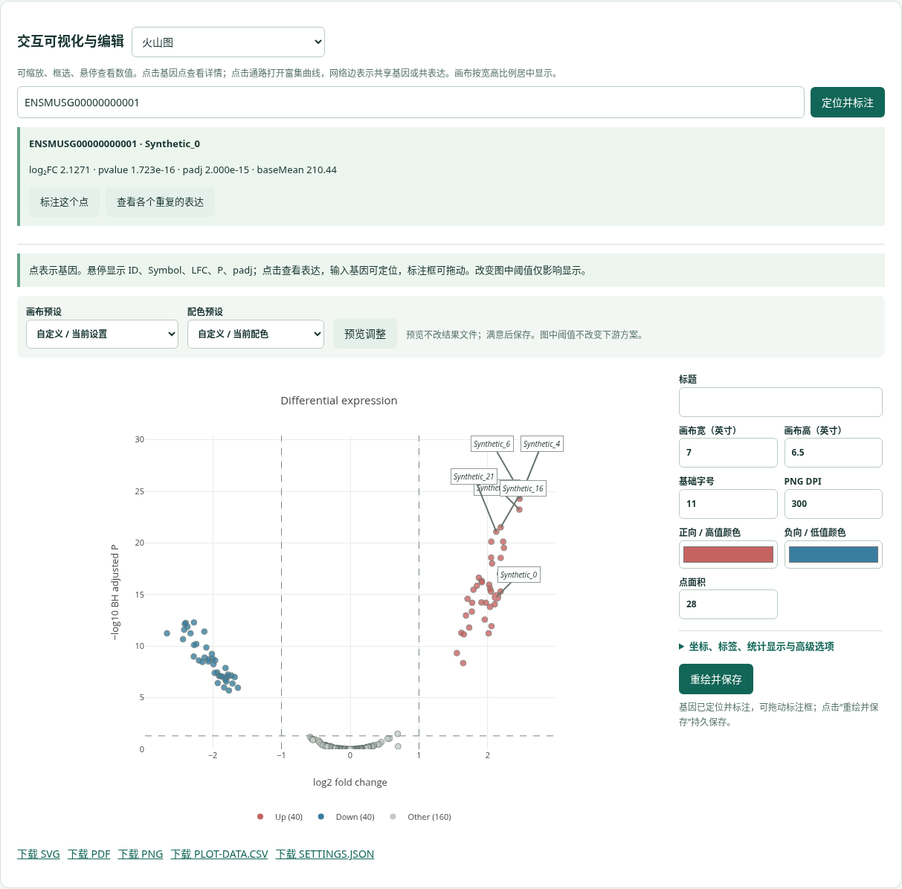

# 小鼠 bulk RNA-seq 工作站 2.0

本地中文网页工作站，支持 Ubuntu / Windows WSL2 Ubuntu 24.04。流程为 **fastp → Salmon → tximport → DESeq2 → GO/KEGG/GMT/fgsea → GSVA/ssGSEA、WGCNA、decoupleR → 交互图与离线报告**。

完整操作、分析原理、结果解读与参考资料见 [使用说明](docs/USER_GUIDE.md)，同版本 [Word说明书](docs/USER_GUIDE.docx) 可直接下载。工作站最后一项 **09 使用说明与方法参考** 支持全文阅读、搜索和下载；无需选择分析项目。网页与Word从同一文稿生成，并由GitHub同步检查。更新本机入口见 [D盘部署与更新](docs/WINDOWS_D_DRIVE.md)。

页面按样本设计、测序质控、表达诊断、差异、富集、通路/基因、网络/表型、报告八步组织。流程和图表改进参考用户报告正文，以及 nf-core、MultiQC、DESeq2、fgsea、GSVA、WGCNA、decoupleR、EnhancedVolcano、ComplexHeatmap、ideal 等成熟项目；具体采用与借鉴范围见 [docs/WORKFLOW.md](docs/WORKFLOW.md)。用户报告和真实客户数据不包含在仓库里。


## Windows D 盘一键部署

下载并全部解压新版源码，双击 **部署到D盘.bat**，创建 **D:\转录组分析工作站** 和桌面快捷方式。以后双击 **启动工作站.bat**，或在 Ubuntu 执行 `bash ~/启动转录组工作站.sh`；默认端口8767，避免与16S的8765冲突。程序/分析结果在D盘，Python环境在Ubuntu，Docker存储保持现有设置。[首次部署、每天启动、固定目录与更新](docs/WINDOWS_D_DRIVE.md)。

## 升级已有工作站

先在旧服务终端 Ctrl+C 停止服务，再在 WSL 的项目目录执行：

```bash
git pull --ff-only origin main
bash install.sh
bash scripts/install_mouse_annotation.sh   # 添加真实小鼠注释，或导入已有离线 TSV
bash launch.sh
```

浏览器打开本机 `http://localhost:8765`；若仍显示旧页面，强制刷新。升级安装 v2 Docker 镜像，保留原来的 `runs/`。旧项目可查看，但双筛选/新挖掘模块需要创建 v2 分析；旧任务没有执行过的新模块不会补上虚假结果。

如果之前下载的是 ZIP，下载新的 GitHub ZIP，将源码放在新目录执行安装；不要覆盖或删除你的数据/运行目录。可通过 `RNASEQ_RUNS` 指定既有结果目录。v1 镜像里的 org.Mm.eg.db 不自动迁入 v2 镜像，请执行新的注释安装脚本，或提供你已有的离线注释表。

## 初次在你的电脑部署

**Ubuntu 本身足够**。Windows 仅负责 WSL2 与浏览器；原生 Ubuntu 同样支持。你已有的 Java 21、Nextflow 25.10.4 可以保留。本工作站由本地任务管理器调度 Salmon/R，不强制使用 Nextflow。

1. Docker Desktop 的 WSL Integration 中开启 Ubuntu-24.04；原生 Ubuntu 使用 Docker Engine。Ubuntu 终端 `docker info` 必须成功。
2. 推荐把源码与数据放在 `/home/用户名/rnaseq/`，避免大型 FASTQ 长期通过 `/mnt/c` 跨文件系统读写。
3. 安装并启动：

```bash
sudo apt update
sudo apt install -y git python3 python3-venv fonts-noto-cjk
git clone -b main https://github.com/kangweihou522-cmyk/H-.git
cd H-
bash install.sh
bash scripts/install_mouse_annotation.sh
bash launch.sh
```

安装完成后在本机浏览器打开 `http://localhost:8765`。Windows 新的一键入口先运行 `部署到D盘.bat`；之后双击D盘的 `启动工作站.bat`，自动选择已安装Ubuntu并打开网页。直接在Ubuntu安装的方式继续使用 `bash launch.sh`。不同发行版可设置 `WSL_DISTRO`，用 `wsl -l -q` 查看实际名称。

默认4线程、容器内存上限24GB，界面允许1–8线程、4–28GB；任务串行，避免多个项目同时耗尽32GB内存。WSL 可选 `%UserProfile%\.wslconfig`：

```ini
[wsl2]
memory=28GB
processors=4
swap=8GB
```

修改前结束分析，在 PowerShell 执行 `wsl --shutdown` 后重启 WSL/Docker。磁盘需求随原始数据、索引、clean FASTQ 和结果增长；预检查会显示剩余空间。关闭服务时避免强行结束正在分析的任务；重启后中断任务会标为失败，可重试，已完成且输入文件信息一致的 fastp/Salmon 步骤可以复用。

首次准备需要 Docker Hub、Debian、PyPI 和（真实小鼠注释）CRAN/Bioconductor；核心R包稳定源码和 Plotly 已在仓库中，SHA256 安装前校验，依赖签名/TLS检查保持开启。完成镜像、参考与注释/GMT准备后，核心分析和页面可离线运行。

## 数据与参考

### FASTQ

准备匹配版本的小鼠 Ensembl cDNA + ncRNA **转录本 FASTA** 与 GTF。用户报告采用 Ensembl 94/GRCm38；你也可以用其他版本，但 FASTA、GTF、tx2gene 和注释必须匹配，不混用版本/组装/品系。界面记录 assembly 与 release，未填写会标作 unspecified。

```bash
.venv/bin/python scripts/prepare_reference.py /data/Mus_musculus.gtf.gz /data/tx2gene.tsv
```

tx2gene为两列带表头TSV，转录本ID须与FASTA一致。tximport忽略转录本版本号，注释时去除基因版本号。不要把基因组FASTA当成转录本FASTA。

样本表 CSV/TSV 使用UTF-8，每个组至少2个生物学重复（推荐≥3），样本名只能含字母、数字、点、下划线、短横线：

```csv
sample,group,fastq1,fastq2,batch,disease_score
C1,Control,/data/C1_R1.fastq.gz,/data/C1_R2.fastq.gz,B1,1.2
C2,Control,/data/C2_R1.fastq.gz,/data/C2_R2.fastq.gz,B2,1.0
T1,Treatment,/data/T1_R1.fastq.gz,/data/T1_R2.fastq.gz,B1,3.1
T2,Treatment,/data/T2_R1.fastq.gz,/data/T2_R2.fastq.gz,B2,2.8
```

单端去掉fastq2列。同一任务不混合单双端；不同lane不是生物学重复，请先合并同一样本匹配的R1/R2。Windows `D:\data\...` 和 file:///D:/... 会转为 `/mnt/d/data/...`。界面有文件浏览和样本读取/保留选择，不自动删除离群样本。

默认fastp质量碱基阈值20、最短长度30，双端检测接头；可在界面调整或为已质控的FASTQ选择跳过。保存fastp JSON/HTML、过滤前后reads、Q20/Q30、GC与碱基曲线，生成MultiQC。不要把报告示例的最短150bp参数直接套到100bp测序。

Salmon开启 selective alignment、seqBias、gcBias。`A`自动判断，双端IU/ISR/ISF，单端U/SR/SF；以建库试剂说明和Salmon方向记录为准。当前使用转录本索引，未集成基因组decoy索引。Salmon记录的fragment mapping不是基因组unique mapping。

### 已有结果

- Salmon：样本表包含 `sample,group,quant`，quant指向quant.sf；提供tx2gene。标准Name/Length/EffectiveLength/TPM/NumReads字段会验证，旁边的metadata、文库方向记录会保留。
- 原始计数：CSV/TSV/文本 `.xls` 的首列为唯一gene，样本列与sample一致，非负整数；不能使用TPM/FPKM/归一化计数。公司名为gene_count.xls的文件往往是TSV，可直接导入；真正Excel二进制请先另存CSV/TSV。
- 计数模式只有表达/统计数据，原始reads质控不会被伪造。默认gene为Ensembl小鼠基因ID；Symbol/Entrez转换来自真实小鼠注释或你提供的TSV。

## 统计设计与双方案选择

“读取样本”后设置一个或多个比较名、对照/处理组（最多30个）。所有组共同拟合DESeq2，每个比较方向为处理/对照。协变量来自样本表，格式 `batch,subject,age:numeric`；batch存在多水平时默认自动加入，输入`none`可明确不调整。混杂、空值、残差自由度不足会在启动前拒绝。配对分析使用subject协变量，并确认独立对象数量。

低表达默认过滤为至少2个样本count≥10，参数可改。结果提供未收缩Wald LFC和可选DESeq2 normal先验收缩；保留原始LFC，Wald stat用于GSEA。

每个比较同时保存：

| 方案 | 条件 | 下游 |
|---|---|---|
| 一 nominal | `pvalue < 0.05`，`abs(log2FC) > 0` | 探索性；未控制FDR |
| 二 strict | `padj < 0.05`，`abs(log2FC) > 1` | BH校正方案 |

先显示两种方案上调、下调、总数，再点击“选择此方案”。不会删除另一方案，也不用重拟合DESeq2。DEG、all/up/down ORA、火山/MA/差异热图随active profile更新；GSEA、ssGSEA、WGCNA、调控活性继续使用全体保留表达基因。没有DEG时明确显示为空，不把未显著基因称作DEG；手动指定基因可作为探索。

## 通路与数据挖掘

GO使用org.Mm.eg.db的GOALL（祖先术语），ORA背景为本次表达、可测试且有对应注释的基因，基因集大小按界面范围过滤；每个方向/ontology对所有可测试集合进行BH，包含零命中集合。GMT使用实际匹配的背景。提供gene ratio、rich factor、背景/命中数量、成员基因。

GSEA实际使用 **fgsea 1.24 multilevel**，Wald stat排序，默认minSize15/maxSize500、seed42、初步排列1000、eps1e-10。输出NES、ES、BH padj、log2err、leadingEdge、排名文件和富集曲线。达到eps下限或统计分布不平衡会在日志中提示；无法可靠计算的项保留NA，不替换为虚假P值。

小鼠KEGG / Reactome / Hallmark /自定义GMT需有权使用且ID一致，每行 `通路ID<TAB>描述<TAB>基因1...`。获取KEGG：

```bash
.venv/bin/python scripts/fetch_kegg.py /data/mouse_kegg.gmt
```

该脚本记录mmu来源、时间和SHA256，界面选ENTREZID。不能联网时导入已有GMT；下载不是制作或启动工作站的前提。人类基因集必须先可靠地转换小鼠同源并记录来源，不能直接当作小鼠数据。

离线注释：带表头 `gene,symbol,entrez,go,ontology` 的TSV，每个GO关联一行，ontology为BP/CC/MF；应包含祖先GO。可从你已安装的包导出：

```bash
docker run --rm -v "$PWD:/project" mouse-rnaseq:2 \
  Rscript /project/scripts/export_mouse_annotation.R /project/annotation.tsv
```

没有真实注释时会明确标记GO未运行。zero-mapping GMT会报错；合成验证注释不用于真实数据。

挖掘模块：

- **GSVA ssGSEA**：每个样本的GMT活性分数，limma使用与DESeq2相同的协变量和比较方向；`logFC`在这里是活性分数差，不是基因log2倍数。
- **关键基因**：ID/Symbol/Entrez查询、各个生物学重复表达、LFC/P/padj，结合leading-edge。数值表型的Spearman关联仅为探索、未调整协变量/全基因多重检验。
- **WGCNA**：≥15独立样本（推荐20+），重复subject当前跳过；VST最高变异3000基因（可调100–6000），signed网络，block≤3000、minModuleSize30、mergeCutHeight0.25；输出soft threshold、模块、eigengene、kME、module–trait及≤500条hub网络边。默认power6需结合signed R²、slope和连接度选择；module–trait当前是未调整协变量Pearson，表内BH，不作因果宣称。
- **调控活性**：提供小鼠 `source,target,weight` TSV（例如DoRothEA，target ID类型可选）。来源/target不可重复，权重非零有限数，每个source至少5个检测到的target。使用decoupleR ULM和同设计limma比较。没有网络或映射不足会说明原因，不生成假TF活动。

## 高级图表与报告

火山图点击/悬停查看基因，输入ID/Symbol定位高亮并标注；可拖动标签位置并保存。SVG/PDF/PNG可调配色、点大小/透明度、字号、自动/指定标签、坐标范围、分辨率和尺寸。导出使用adjustText避让，交互使用本地Plotly，点有边框、虚线阈值、标签框/引线。

PCA主成分/分组配色、热图聚类/自选基因/Symbol/分组色条、基因表达box+每个重复、GO/KEGG点图、GSEA曲线、活性热图、WGCNA诊断与module–trait均可探索。点击DE表/热图基因进入基因信息，点击GSEA通路进入曲线。编辑图中阈值只改变显示；下游DEG方案请用双方案按钮切换。

下图是工作站真实浏览器中的合成数据演示，已验证鼠标点击点、拖动标签并保存；不是客户实验结果。



导出离线HTML（内嵌SVG）、完整结果ZIP，以及每图SVG/PDF/PNG/数据/设置。报告包含实际参数、两方案计数、输入、设计、模块完成/跳过状态。结果在 `runs/任务ID/`：RDS、R-session、归一化/VST/TPM（Salmon入口）、profiles、contrast清单、日志与输入文件信息。ZIP不含FASTQ/索引/完整quant目录。

## 验证和分析边界

见 [VALIDATION.md](VALIDATION.md)。使用本地合成FASTQ/计数/注释/GMT/调控网络，运行真实工具，不依赖官方测试reads下载。实际实验需确认设计、参考版本、注释和实验QC；没有把合成验证当作真实生物学发现。

原报告中的基因组区域分布、基因体覆盖、IGV、新转录本、rMATS剪接、GATK/SnpEff变异与STRING蛋白互作需要独立BAM/资源模块，未由本主线执行，不从Salmon推算。核心R/浏览器代码来源和许可见 [docs/THIRD_PARTY.md](docs/THIRD_PARTY.md)。服务仅监听本机loopback，不直接暴露公网。
