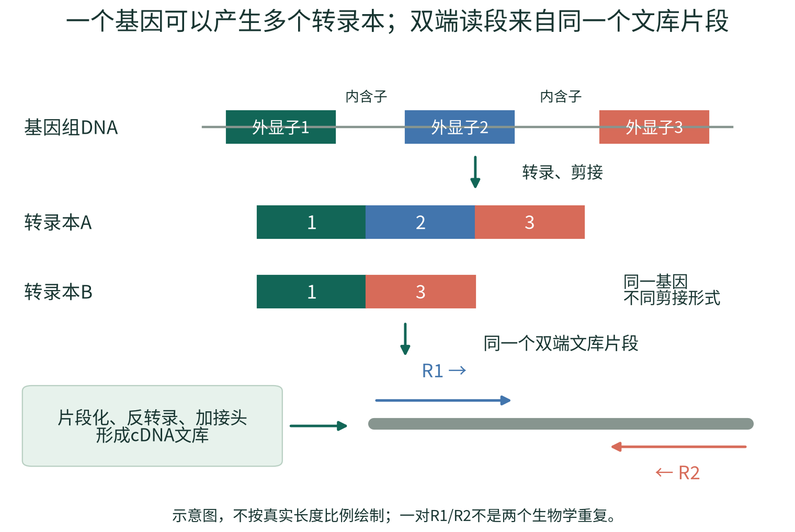
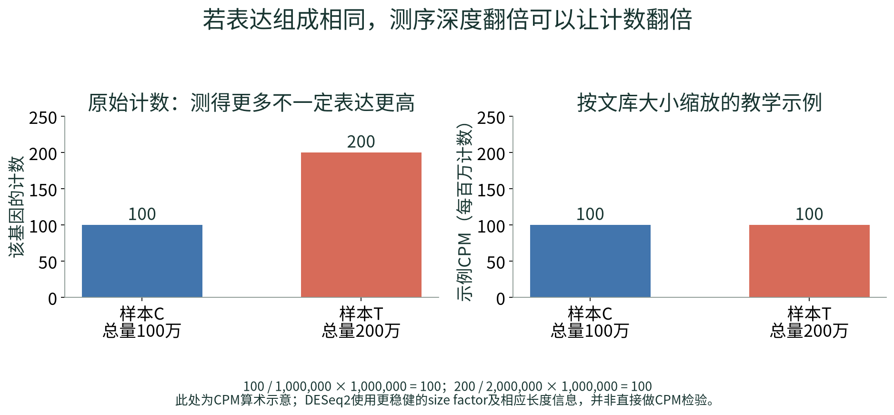
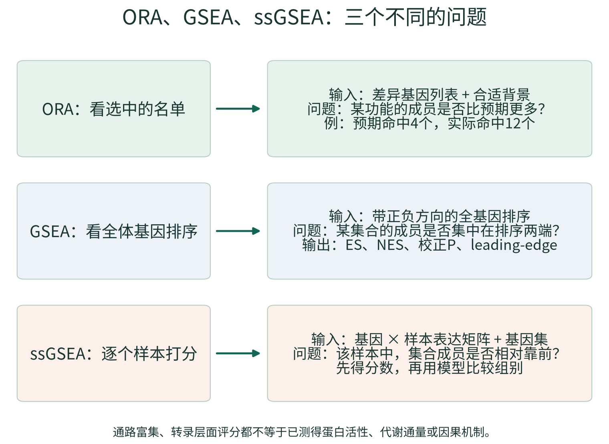
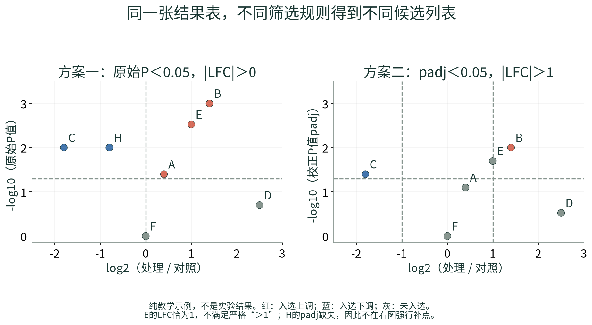

# 小鼠 bulk RNA-seq 从零入门与工作站实操教程

说明书版本：2026.10.26-r2

适用程序：小鼠 bulk RNA-seq 工作站 2.0，Windows + WSL2 Ubuntu 24.04 或原生 Ubuntu。本文对应当前仓库实际实现；每个任务的真实设计、软件版本与完成状态，以该任务保存的参数、R-session、日志和报告为准。说明书编写日期：2026-10-26。

本版按新手学习顺序重写：先理解RNA、建库测序、计数和统计，再使用软件。重要术语在首次出现时解释，配有原理图、计算例子、结果判读和自测答案；操作部分继续对应实际程序。示例样本名、数值、基因和路径仅用于教学，不代表实验发现。工作站不会把演示注释或合成数据当作真实小鼠生物学证据。

## 导读：先学知识，再按工作站步骤操作

这份教程分成两层。前面的“入门1—入门9”解释测序与分析究竟在做什么；后面的第1—26章对应工作站的操作、方法细节和可追溯资料。第一次接触转录组时，建议先读入门部分，再按实际输入类型完成操作。遇到术语，可回看文末按主题分组的词表。

| 你现在的目标 | 建议阅读顺序 | 读完应能做出的判断 |
|---|---|---|
| 第一次认识RNA-seq | 入门1—6 → 入门9 | 能说明样本如何变成读段、基因计数与结果表 |
| 准备自己的实验 | 入门7—8 → 第3—5章 | 能区分独立重复、技术重复、配对和批次混杂 |
| 判断一份差异结果 | 入门8 → 第8—10章 → 第18章 | 能同时解释变化大小、重复间波动、P与padj |
| 理解GO/KEGG/GSEA | 入门9 → 第11—16章 | 知道数据库、富集检验、样本评分分别是什么 |
| 在当前电脑上操作 | 第2、4、5章 → 对应结果章节 | 能启动、选择正确入口、核对当前项目并找到输出 |

阅读时反复问四个问题： **输入是什么？这一步解决什么偏差或问题？输出是什么单位？它不能证明什么？**  不必先掌握所有公式，但必须理解这些问题。本文所有教学数字和图都是人为构造的示例，不是你的实验结果，也不是公司报告的重新计算结果。

## 入门1：RNA-seq测量的是什么

### 从DNA、基因到RNA和转录本

DNA是保存遗传信息的分子；基因是基因组上与某种功能产物有关的一段序列。一个基因被 **转录** 后产生RNA。对许多真核蛋白编码基因而言，初始RNA经过加工、剪接，把部分区段连接成成熟RNA；最后可以被翻译成蛋白。但也有许多RNA不编码蛋白。

 **外显子（exon）** 是保留在相应成熟转录本中的区段； **内含子（intron）** 是加工时被移除的区段。外显子不等于“全部能翻译成蛋白”：外显子中也可能包含不被翻译的区段。一个基因可以采用不同的剪接组合或起止位置，形成不同的 **转录本（transcript，也常称isoform）** 。因此，“有多少基因”和“有多少转录本”不是同一个问题。



图1的彩色区段仅用来帮助理解。图1中的同一基因产生转录本A和B时，基因层面的表达可以概括这个基因的总信号；但基因表达不变，并不保证两个转录本的比例没有改变。当前主线最后以基因层面的差异分析为主，不能把它直接称为差异剪接分析。

### “表达高”是什么意思

在RNA-seq中，表达通常指某个基因或转录本的RNA在样本中的相对丰度。RNA更多，通常有更多机会被抽取、建库和读到；但实际读到多少还受文库制备、测序深度、序列偏好、转录本长度及样本组成影响。因此，读段数量是丰度的带有技术影响的观测，既不是每个细胞的精确分子数，也不是蛋白量。

 **转录组（transcriptome）** 是某个样本、状态和时间下的RNA集合。DNA可以大体相同，但肝脏和肌肉、处理前和处理后，哪些基因被转录以及转录多少可以不同。RNA-seq就是通过测序去观察这种差异。

### bulk为什么特别需要注意细胞组成

bulk RNA-seq把一块组织或一群细胞的RNA混合后测量，得到的是混合信号。例如，处理组组织中免疫细胞比例从10%增加到30%，一个免疫细胞相关基因可能升高，即使每个免疫细胞内该基因的表达都没有变化。

所以，“这个基因在组织中升高”与“这个基因在某一种细胞内被上调”是不同结论。当前工作站没有内置细胞成分去卷积；判断细胞来源需要额外标记、独立细胞比例信息或专门方法。RNA增加也不自动表示蛋白增加、酶活性增强或疾病因果作用。

如果你熟悉16S，可以这样对照：16S常以ASV/分类群的相对组成回答“有哪些微生物、比例怎样”；这里以基因/转录本回答“样本中的哪些RNA相对更多或更少”。两者都面临组成和重复问题，但对象、参考数据库和统计模型不能直接互换。[22,23]

## 入门2：一管RNA怎样变成可以分析的测序文件

### 常见短读长RNA-seq实验链条

| 实验步骤 | 通俗理解 | 为什么会影响后续结果 |
|---|---|---|
| 取样、提取RNA | 从真实组织中得到RNA | 取样位置、保存时间、降解、DNA污染都可能改变信号 |
| 检查RNA质量 | 检查材料是否完整、是否适合建库 | RIN、DV200等来自实验检测，不是工作站从计数表推算的值 |
| 富集或去除某些RNA | 让有限的测序量集中到目标RNA | poly(A)富集与去rRNA的检测范围和偏倚不同 |
| 片段化与反转录 | 把较长RNA处理成适合建库的片段，并制成cDNA | 片段大小、降解和酶反应会影响覆盖与偏好 |
| 加接头、样本索引及扩增 | 加上测序所需的“接口”和样本标签，按方案进行PCR | 接头残留、索引错误和扩增偏倚可影响读段 |
| 测序与拆分样本 | 读取碱基，再按样本索引区分不同文库 | 最终得到每个样本的FASTQ及质量值 |

这是常见工作流的概括，不代表所有试剂盒步骤、顺序和参数完全相同。应保留建库说明书及公司提供的实验质控记录。

其中，RIN（RNA integrity number，RNA完整性指标）通常以1—10评分概括相应检测到的完整性，较高一般表示更完整；DV200表示长度大于200个核苷酸的RNA片段所占比例，常在降解材料等情境作为参考。它们不是同一单位，也不能脱离检测方法和建库方案设一个所有实验通用的合格线。工作站没有原始实验检测信号，不能从FASTQ或计数矩阵补算出这些指标。

### poly(A)富集和去rRNA为什么不能当作同一件事

许多成熟mRNA具有poly(A)尾，可以据此富集，减少其他RNA占用测序量，但可能遗漏不带相应尾结构的RNA；降解还会带来覆盖偏倚。去rRNA则针对大量存在的核糖体RNA进行去除，常保留更广的其他RNA，具体结果取决于试剂方案。

核糖体RNA本身是正常细胞RNA；问题通常是它是否占用了本次实验不希望花费的大量测序量。当前FASTQ质控和Salmon映射率不能独立给出精确的rRNA污染比例。没有测量或专门分析时，不要把“低映射率”直接改写成“rRNA污染已证实”。

### 测序仪是怎样“读字母”的

常见Illumina短读长测序使用边合成边测序的思想：许多文库片段在流动槽上形成可被检测的信号簇；每个循环掺入并识别碱基，仪器把信号转成A/C/G/T及对应的可信度。这与直接观察完整RNA分子不是一回事。实验通常读的是cDNA文库。[24]

把常见的“边合成边测序”再拆开看，可以理解为反复进行以下循环：

1. 一个文库片段被扩增成足以检测的信号簇，使相应序列的信号更容易读取。
2. 测序反应引入可被识别、并暂时限制继续延伸的核苷酸；按模板加入相应互补碱基。
3. 对信号成像或进行相应检测，软件判断这个簇在当前循环对应哪个碱基。
4. 去除相应标记或阻断后，继续下一个循环；不同平台具体通道和化学设计有所不同。
5. 多个循环的碱基判断串起来形成read，同时依据判断的可靠性给出质量值。

因此，FASTQ中既有“读到了什么”，也有“每个位置有多可靠”。仪器不能通过某个单独颜色直接读出“这个基因升高2倍”；基因丰度需要经过后续匹配、计数、归一化和统计才获得。一个循环的质量也不等于整个实验是否设计正确。

样本索引使多个文库可以一起上机后再拆分；样本属于Control还是Treatment仍依赖实验记录和样本表，不是软件从序列中自动识别。组别填错时，程序可能顺利跑完，但生物学解释会错误。

样本索引（index/barcode）用于区分文库；UMI是特定建库方案给原始分子增加的随机标记，用来辅助识别扩增副本。它们不是同一个概念。当前工作站不提供通用UMI解析与去重流程，也不把每个普通read直接当作一个独立原始RNA分子。

## 入门3：reads、fragments、R1/R2、测序量和文库方向

### 一次观测到底按什么计数

 **read（读段）** 是一段测得的碱基序列； **fragment（片段）** 是被测序的文库片段。单端测序通常读一个端；双端测序从同一片段两端分别读出R1和R2。于是，一对配对读段包含两个reads，但通常对应一个fragment。它们可能重叠，也可能中间存在没有被直接读到的区段。普通bulk RNA-seq中，相同序列既可能来自扩增副本，也可能与真实高丰度RNA有关；没有合适建库信息时，不能按“序列相同”就把所有重复全部删除。

例如，1000万对PE150读段，意味着约2000万条reads，名义测得约30亿个碱基；它不是2000万个独立动物，也不保证等于1000万个独立RNA分子。过滤、异常配对及重复等情况还会改变后续可用数量。`PE150`表示双端每端约150个碱基，不表示每个RNA或文库片段只有150个碱基。

| 名称 | 单位或含义 | 最常见的误读 |
|---|---|---|
| read length | 每条读段读到多少碱基，如150bp | 当作文库片段的完整长度 |
| insert/fragment length | 接头之间的文库片段长度 | 当成R1读长；双端读长之和也不一定等于它 |
| sequencing depth | 本次获得的reads、read pairs或bases | 比较两个报告时不核对单位 |
| library size | 按上下文可指总读段或计数矩阵列总量 | 当作细胞总RNA量；两种“总量”也未必相同 |
| biological replicate | 独立生物学对象，如不同小鼠 | 把R1/R2、不同lane或重复上机当独立对象 |

测序更深通常有助于观察低丰度RNA，但不保证增加同样多的新信息，也不能弥补没有生物学重复的设计。对于明确的问题，取样代表性、独立重复和技术一致性往往比一味追加reads更重要。

### 双端不等于链特异性

链特异性（strandedness）表示建库是否保留原始RNA来自哪一条方向的信息。双端/单端描述“读几个端”，链特异性描述“是否及如何保留方向”，这两个维度相互独立。Salmon中的文库类型是对方向和配对关系的约定，需结合建库试剂和定量结果确认；不能因为文件有R1/R2，就任意选择ISR或ISF。

同一个文库分到多个lane时，仍是同一个生物学样本。正确合并匹配的R1与R2可以增加可用测序量，但不会增加差异分析中的独立样本数。

## 入门4：FASTQ、Phred、Q20/Q30与“质量合格”的含义

### 先看一条最小FASTQ记录

```text
@C1_fragment0001/1
ACGTACGTACGT
+
IIIIIIIIIIII
```

四行依次是读段名称、碱基序列、分隔行、逐碱基质量字符。这里序列与质量字符都为12个。现代常见Phred+33编码中，字符`I`的ASCII值为73，对应质量分数40；这是编码示例，不是让你根据字母外观估计整个样本的质量。`.fastq.gz`表示文件经过压缩，解压后记录的生物学含义不变。

Phred质量分数与单碱基错误概率的关系为：`Q = -10 × log10(错误概率)`。它是测序仪给出的概率估计，需要与样本情况一起解释。

| 质量分数 | 对应单碱基错误概率 | 直观理解 |
|---|---|---|
| Q10 | 10% | 平均约每10个这样的碱基有1个错误 |
| Q20 | 1% | 平均约每100个这样的碱基有1个错误 |
| Q30 | 0.1% | 平均约每1000个这样的碱基有1个错误 |
| Q40 | 0.01% | 平均约每10000个这样的碱基有1个错误 |

Q30比例为90%，表示约90%的碱基质量达到或超过Q30。它不表示“90%的基因是真的”，也不表示“所有reads都90%正确”。整条read全部无错的概率还与各碱基质量和读长有关；不能把单碱基概率直接当作整条序列的概率。

### 为什么要做接头和质量处理

接头是建库所需的人工序列，不是目标生物转录本。当片段较短或读过目标片段边界时，读段可能包含接头。低质量尾端和接头会干扰后续匹配，fastp用于检测、修剪或过滤这些情况，并记录处理前后的变化。

过滤不是“越严越好”：若把100bp数据的最短保留长度误设为150bp，可能把有效reads大量删除。应结合读长、保留比例、接头、每碱基质量曲线和样本一致性判断，不靠单个Q30或单一经验阈值裁决。GC含量反映G/C碱基比例，还受物种、组织、RNA类型和文库策略影响；它偏离某个数值并不能单独证明污染。

 **导入提示不等于质量失败。**  当你只导入计数矩阵或已有Salmon结果，程序没有原始FASTQ证据去重新计算reads/Q30。质控页写“没有执行原始FASTQ质控”是在交代证据来源，不是判定样本差。此时仍能做表达分布、PCA和样本相关性检查；若需原始测序质量，应补齐FASTQ或查阅原始实验质控报告。

## 入门5：参考基因组、转录组、注释和基因ID

可以把参考序列理解为“可匹配的文字”，把注释理解为“这些文字的位置、边界、名字和关系”。二者配套，软件才能知道匹配到哪里、属于哪个基因。

| 资源 | 常见格式 | 里面装的是什么 | 在当前工作站中的作用 |
|---|---|---|---|
| 基因组参考 | FASTA | 染色体或其他基因组序列 | 是理解组装和基因位置的基础；不能冒充转录本FASTA输入主线 |
| 转录本参考 | FASTA | 按相应注释定义的转录本序列 | Salmon索引与定量的直接参考 |
| 基因结构注释 | GTF/GFF | 基因、转录本、外显子等位置及属性 | 当前可用匹配GTF构建tx2gene，不代表运行了基因组比对 |
| 转录本—基因对应 | TSV | 哪个转录本属于哪个基因 | tximport将转录本汇总到基因所需的字典 |
| 功能注释 | TSV或注释数据库 | Symbol、Entrez、GO等对应关系 | 帮助查询和功能分析；它不是表达量 |
| 基因集合 | GMT | 一个集合名及其成员ID | 提供GO/KEGG/其他集合的分析对象 |

FASTA通常以`>`开头的标题行加序列行组成；FASTQ还包含每个碱基的质量值，二者不能互换。GRCm38与GRCm39是不同组装；Ensembl的release是注释版本。只说“都是小鼠文件”仍不足以保证它们配套。

基因与转录本ID也不同：小鼠Ensembl基因ID常以`ENSMUSG`开头，转录本常以`ENSMUST`开头；Symbol是如常见基因名称的可读标签；Entrez是另一套编号体系。去掉版本后缀只是在特定条件下处理同一编号的版本形式，不能把人类变成小鼠，也不能自动修复组装不一致或一对多映射。

同一个Symbol可能有别名、旧名或映射歧义。优先保留原始ID，并把Symbol作为注释显示；发现查询匹配多行时，回到实际ID确认。无法注释的基因并不自动是假基因或错误读段，也不能随意套上一个熟悉的名字。

## 入门6：为什么不能直接拿counts、TPM和FPKM混着比较

### counts是怎样来的

基因计数矩阵通常一行一个基因、一列一个样本，格子表示分配给该基因的测序观测数量。对Salmon而言，一些片段可以兼容多个转录本，软件会根据模型估计归属，所以估计计数可能不是整数。工作站通过tximport的标准入口处理这类定量；“导入原始基因计数”入口则要求非负整数，不能把小数TPM随意四舍五入后塞进去。

### 例1：测得更多，可能只是测得更深

假设同一基因在C样本计数100，在T样本计数200；C的总量为100万，T为200万。在表达组成相同的简化前提下，它们都占总量的万分之一。直接说“处理后升高2倍”会把测序深度差当成表达差。



图2只演示每百万计数CPM的算术：`100 / 100万 × 100万 = 100`，`200 / 200万 × 100万 = 100`。 **实际DESeq2并不是只按列总数做CPM。**  它通常利用许多基因的计数比例估计较稳健的size factor；通过tximport入口时，还处理对应的长度相关信息。

size factor可以直观理解为“这个样本的计数整体需要怎样缩放，才更可比”。它依赖数据和模型的合理性；严重的全局表达组成改变、批次混杂或细胞比例差异，不会因做了一次归一化而自动消失。归一化也不等于把所有样本改成一样。

### 再走一步：DESeq2的size factor为什么不只看总数

常用的median-of-ratios思路，可拆成“为每个基因建立跨样本参考 → 每个样本与参考作比 → 对许多基因的比值取中位数”。中位数比简单总数较不容易被少数特别高的基因牵着走，这就是这里“稳健”的直觉。软件不是预先知道哪些基因不变；它依赖数据整体构成满足相应条件。

暂不讨论转录本长度offset，只用两个样本、三个基因演示算术。这不是可提交给工作站的完整统计实验：当前程序仍要求足够的独立样本和保留基因。

| 教学基因 | C计数 | T计数 | 跨两样本几何均值 | C/参考 | T/参考 |
|---|---|---|---|---|---|
| G1 | 100 | 200 | 约141.4 | 约0.707 | 约1.414 |
| G2 | 200 | 400 | 约282.8 | 约0.707 | 约1.414 |
| G3 | 100 | 1000 | 约316.2 | 约0.316 | 约3.162 |

几何均值在两个正数时为它们乘积的平方根。分别对最后两列取中位数，得到C的示例size factor约0.707、T约1.414，相对尺度差约2倍。把各计数除以对应因子后，G1的C和T都约141.4；G3则约141.4与707.1，相对约5倍。这样，单个强变化基因不会必然把全部变化都当作文库总量差抹掉。

实际还要处理零计数、可用基因、设计、离散度以及tximport的长度信息。大量基因严重单向改变时，默认归一化前提也可能受挑战；必要时应在实验设计中考虑合适的外部标准，而不是把此小例子当作所有数据的保证。[4]

### 例2：长度较长的转录本更容易贡献测序片段

在相同分子数量和简化采样条件下，较长转录本通常有更多位置可以产生片段。TPM因此按有效长度及整体丰度构造相对表达指标。用普通长度替代有效长度的教学例子如下：

| 转录本 | 长度 | 计数 | 每kb的计数RPK | 在这个二成员示例中的TPM |
|---|---|---|---|---|
| A | 1kb | 100 | 100 | 约666667 |
| B | 2kb | 100 | 50 | 约333333 |

TPM全称transcripts per million。先得到RPK，再除以全部RPK之和并乘100万，所以该例TPM合计100万。两个转录本counts相同，不代表按长度考虑后的相对丰度相同；反过来，TPM相同也不表示原始计数相同。Salmon使用更完整的有效长度和偏好模型，这张表只是解释单位的例子。[2,25]

FPKM全称fragments per kilobase per million mapped fragments，意为每千碱基、每百万片段的标准化值；RPKM按reads定义；TPM先做长度处理再统一缩放。不能仅因为它们都叫“标准化表达”，就互相替代。TPM/FPKM适合相应表达展示或特定模型，不是当前DESeq2原始计数入口的输入。

| 数据形式 | 当前工作站的主要用途 | 不适合做的事 |
|---|---|---|
| 原始或标准tximport入口的计数 | DESeq2计数模型 | 把不同测序深度的原始值直接当效应 |
| normalized count | 同一基因在不同样本中的表达查看 | 解释为精确RNA分子数；直接跨基因比绝对丰度 |
| TPM | 在约定参考与组成下展示相对表达 | 四舍五入后作为原始counts输入DESeq2 |
| VST | 稳定均值—方差关系，便于PCA、距离和部分挖掘 | 当作counts或当作已经去掉所有批次的矩阵 |
| 行Z-score | 展示每个基因相对自己均值的变化模式 | 据颜色比较不同基因的绝对表达高低 |

## 入门7：先设计实验，才有可解释的统计比较

### 重复的关键是“独立”，不是文件数量

比较处理组和对照组，需要知道组间差异是否大于同类样本本来就有的波动。独立小鼠之间的差异有助于估计这种生物学波动；同一份RNA重复上机主要说明技术稳定性，不能替代另一只动物。

贯穿本文的示例为对照C1、C2、C3与处理T1、T2、T3，每个样本来自不同小鼠。它有每组3个生物学重复。R1和R2属于同一个样本，两个lane也不能让每组样本数从3变成6。每组3只是常见起点，不是保证统计功效的万能数量；正式样本数需结合变异、预期效应和研究问题规划。

### 配对、协变量和批次究竟在说什么

如果同一动物有处理前后两次测量，两次观测共享这个动物的背景，可考虑配对。`~ subject + group`的直觉是先区分“每个动物本来就不同”，再估计处理因素；当前实现是固定效应的加性模型，不是任意重复测量或随机效应模型。

 **协变量（covariate）** 是模型中需要同时考虑的变量，如批次、年龄或对象。 **批次（batch）** 是不同日期、试剂批号、操作批或平台等带来的系统差异。把批次加入模型，是在数据允许的条件下估计调整后的组别效应，不是把所有表达矩阵都“洗成没有批次”。

最危险的例子：全部对照在周一建库、全部处理在周五建库。此时组别与批次完全重合，软件无法仅靠现有数据判断变化来自处理还是建库日期，称为 **完全混杂（confounding）** 。把“batch”写进表格并不能创造缺失的信息。更好的办法是在设计阶段让不同组分散到各批次，并记录真实来源。

样本排除也应有可解释的理由，例如标签确认错误或独立的严重质量证据。仅因为某个点让PCA不漂亮，或者删掉后更显著，就删除样本，会使结论产生选择偏差。保留原始数据、排除理由和必要的敏感性对照。

## 入门8：倍数、P值、padj、FDR和“没有显著差异”

### 变化有多大：先理解fold change和log2FC

fold change（FC，倍数变化）通常按处理/对照定义。对数只是把倍数改成对称、便于画图的尺度：`log2FC = log2(FC)`。

| 处理/对照倍数 | log2FC | 通俗解释 |
|---|---|---|
| 4 | 2 | 处理组约为对照4倍 |
| 2 | 1 | 约2倍 |
| 1 | 0 | 约相同 |
| 0.5 | -1 | 约为一半 |
| 0.25 | -2 | 约为四分之一 |

“上调/下调”必须带比较方向。交换处理和对照会翻转log2FC符号。模型调整或收缩后的log2FC还不一定等于两个简单平均值之比。效应大不保证证据强，效应小也可能因重复稳定而有很小P值。

### P值回答的是证据问题

可以把零假设理解为“在指定统计模型下，待比较的组别效应为零”。P值考察：在该假设及模型前提下，出现至少这样极端统计结果的概率。它 **不是** “这个基因为假的概率”，也不是“处理有97%的可能性有效”。

试想两个基因都平均升高2倍。第一个在三个处理样本中稳定升高；第二个只有一个处理样本极高、另外两个接近对照。它们的均值和倍数可能相近，但对稳定组别效应的证据不同。差异分析需要同时考虑效应和样本间变异，而不是只排倍数。

### 为什么同时看几万个基因时要校正

在一个纯教学假设下，若检验10000个实际上无差异的基因，且各原始P在零假设下校准良好，仅用`P < 0.05`，平均可能筛出约500个假阳性。实际数据不是简单的“恰好500个”，但这个例子解释了多重检验问题。

BH是Benjamini–Hochberg方法名称的缩写，是控制假发现率的一种常用方法。 **FDR（false discovery rate，假发现率）** 关心所报告发现中的假阳性比例在相应统计意义下的控制；它不是每个入选基因各自“有5%错误”的保证。 **padj** 是调整后的P值，DESeq2使用相应的BH校正和过滤机制。

五个P值的BH教学算术如下；实际算法还需保证调整值的单调性并限制在1以内：

| 排序名次i | 原始P | 简化计算 `P × 5 / i` | 本例BH调整值 |
|---|---|---|---|
| 1 | 0.001 | 0.005 | 0.005 |
| 2 | 0.020 | 0.050 | 0.050 |
| 3 | 0.040 | 约0.0667 | 约0.0667 |
| 4 | 0.200 | 0.250 | 0.250 |
| 5 | 0.800 | 0.800 | 0.800 |

因此“原始P为0.02”不等于“校正后也小于0.05”。这个五基因例子不能直接拿来重算DESeq2结果，因为实际测试集合、独立过滤、缺失值等会影响校正。工作站采用严格`<`，所以本例恰为0.050也不满足`padj < 0.05`。[4,5]

### 不显著不等于已经证明没变化

小样本、个体变异大、表达低或效应较小，都可能让统计功效不足。功效是研究在设定条件下发现真实效应的能力。`padj > 0.05`表示当前数据与模型下证据不足，不是证明效应必为零；也不能因此自动宣称原始P方案更“真实”。应结合效应、变异、设计和后续验证解释。

缺失值`NA`不是零。低信息基因、过滤或异常影响处理等可导致部分统计量缺失，需看实际原因；不能把NA改成极小P来让火山图更好看。

## 入门9：把整条流程串成一条证据链

### 三种入口，拥有的证据不同

FASTQ入口从读段及质量开始；Salmon入口从已完成的转录本定量开始；计数入口从基因矩阵开始。后两者并不是“不完整的假分析”，而是在已经拥有上游结果的前提下从相应位置继续。关键是如实保留哪些步骤做过、由谁做、使用什么参考和参数。

```text
组织/细胞 → RNA提取与建库 → FASTQ（实验与测序环节）
                              ↓
                         fastp读段预处理
                              ↓
                        Salmon转录本定量
                              ↓
                 tximport基因汇总与长度信息
                              ↓
           基因计数、样本表 → 归一化与样本结构检查
                              ↓
                 DESeq2模型 → 每个基因的效应与检验
                      ↙                  ↘
           按规则筛选DEG名单             全基因排序/表达
                    ↓                       ↓
                  ORA               GSEA、ssGSEA等
                      ↘                  ↙
                通路与候选基因 → 独立验证
```

工作站从FASTQ、Salmon或计数入口开始，不替代前面的动物实验、RNA提取、建库与测序。每一个箭头都依赖前一步质量；后面的显著结果无法反过来证明前面的设计正确。

### 数据库不是分析方法

 **DEG（differentially expressed genes，差异表达基因）** 是按声明的效应和统计规则得到的基因名单。它不是原始测序文件，也不是一套固定不变的生物学标签。

GO、KEGG、Reactome和Hallmark提供不同方式组织的功能知识或基因集合。ORA、GSEA和ssGSEA则是利用这些集合提出统计或评分问题的方法。说“做了KEGG”还不够，应该说明“对哪些基因，以什么背景，做了KEGG ORA”，或“用什么排序做了KEGG基因集GSEA”。



例如，某炎症集合可以同时用于ORA、GSEA和ssGSEA，但三种结果不是同一个P值的三种画法。ORA看选中名单是否命中过多；GSEA看成员是否在全排序两端聚集；ssGSEA先给每个样本算分，再用模型比较组别。第12—14章会给出具体数字和解读。

### 六个样本的简化贯穿例子

假设我们研究一种处理是否改变小鼠肝脏转录状态，有C1—C3和T1—T3六只独立小鼠，组别跨批次安排。先确认样本表、质量和参考一致，再建模。以下假设结果仅用于阅读练习，不是从前面某个小计数表计算出来的DESeq2结果。这是较大结果表中抽出的七行，padj不是只对这七行重新计算的BH结果：

| 示例基因 | log2FC | 原始P | padj | 能说什么 |
|---|---|---|---|---|
| A | 0.4 | 0.040 | 0.080 | 变化约1.32倍；原始P有探索信号，但未通过当前FDR阈值 |
| B | 1.4 | 0.001 | 0.010 | 变化约2.64倍；同时满足两套筛选 |
| C | -1.8 | 0.010 | 0.040 | 约为对照0.29倍；同时满足两套筛选，方向为下调 |
| D | 2.5 | 0.200 | 0.300 | 点在横轴较远处，但当前统计证据不足 |
| E | 1.0 | 0.003 | 0.020 | 约2倍，但不满足本工作站严格的`|LFC| > 1` |
| F | 0.0 | 1.000 | 1.000 | 不满足任一方案 |
| H | -0.8 | 0.010 | NA | 可进入原始P探索名单；不能当成校正P显著 |

在这张纯教学表中，方案一入选A、B、C、E、H共5个；方案二入选B、C共2个。一个基因是否入选，同时取决于选定的P列、阈值、效应大小和缺失值处理，不是图上颜色的主观选择。



下一步应回看各重复表达、模型和注释，再解释通路；不要直接把“B入选了多个名单”写成“B已被证明是关键致病机制”。贯穿示例的任务，是教你问对问题，而不是给出一份预设的生物学答案。

## 1. 工作站能完成什么

本工作站面向小鼠组织、细胞或其他混合样本的 bulk RNA-seq。常规主线是：样本与实验设计 → 原始读段预处理 → Salmon 转录本定量 → tximport 基因汇总 → DESeq2 差异分析 → GO/KEGG/其他 GMT 富集 → 单样本通路和调控活性 → 共表达与表型探索 → 图表编辑、报告及结果归档。

分析不要求先下载官方测试数据。可以直接使用自己的 FASTQ、已有 Salmon 定量或原始基因计数；合成演示仅用于验证程序是否能执行。首次安装依赖和获取参考文件通常需要联网，准备好镜像、参考、真实注释及基因集后，核心统计和网页操作可离线完成。

| 输入入口 | 从哪一步开始 | 能提供的结果 |
|---|---|---|
| FASTQ | fastp 预处理、Salmon 定量 | 测序/定量质控、表达、差异、富集和满足条件的挖掘模块 |
| Salmon quant.sf | tximport 基因汇总 | 保留下来的定量元数据、表达与后续统计；不重做原始 reads 质控 |
| 原始基因计数 | DESeq2 建模 | 表达与后续统计；没有原始 reads 质控和转录本长度信息 |

界面按“样本与实验设计、测序与定量质控、表达与样本诊断、差异基因、GO/KEGG/GSEA、通路与关键基因、共表达与表型、报告与导出”组织，最后提供本使用说明。按顺序查看结果比直接寻找显著基因更可靠：输入或样本质量有问题时，后面的精美图表不能纠正前面的偏差。

## 2. 本地部署、启动与保存位置

### 2.1 Windows、Ubuntu、Docker 分别负责什么

Windows 提供文件管理和浏览器；WSL2 Ubuntu 承载 Linux 分析环境；Docker 将 Salmon、R 及相关分析包放在相对固定的计算环境中。网页是控制界面，真正的分析在本机后台执行。仅打开 Ubuntu 窗口不会自动启动网站；关闭浏览器也不等于停止计算。

对于已有 Windows + WSL2 的电脑，推荐继续使用该组合，不需要为了本工作站改成纯 Ubuntu。Java 和 Nextflow 可以保留，但本工作站目前由本地任务管理器调度，并不要求通过 Nextflow 执行。

### 2.2 首次部署与每天打开

首次下载 GitHub 源码 ZIP 后全部解压，在解压目录双击 `部署到D盘.bat`。默认目标为 `D:\转录组分析工作站`，默认网页端口为 `8767`。完成部署后，每天双击目标目录里的 `启动工作站.bat` 或桌面快捷方式，即可调用 Ubuntu 后台并打开浏览器。

也可以打开 Ubuntu，执行部署时生成的命令：

```bash
bash ~/启动转录组工作站.sh
```

如果同名脚本已被用户修改，安装器可能保留旧脚本并生成 `~/启动D盘转录组工作站.sh`，以部署输出的实际路径为准。采用 Windows D 盘入口时，浏览器地址通常是 `http://localhost:8767`；直接在 Ubuntu 源码目录运行 `bash launch.sh` 时默认端口为 `8765`，不要混淆两个运行位置。

分析期间保持工作站终端运行、电脑不休眠；使用 Docker Desktop 时保持其引擎运行，使用 Ubuntu Docker Engine 时保证其服务可用。正常关闭先确认任务结束，再在工作站终端按 Ctrl+C。

### 2.3 哪些东西在 D 盘

| 位置 | 保存内容 |
|---|---|
| `D:\转录组分析工作站\程序\版本摘要\` | 各版本源码；更新通常生成新目录 |
| `原始数据\` | 用户自行放入的 FASTQ、样本表、计数等；不会自动搬移已有文件 |
| `参考文件\` | 用户准备的 FASTA、GTF、tx2gene、注释和 GMT |
| `分析结果\任务ID\` | 每次分析的数据、图表、报告、参数及日志 |
| `导出报告\` | 可手动选择的导出目标；浏览器默认下载目录不被强制改写 |
| `配置\workstation.json` | 生效的程序目录、发行版、端口和 Python 环境路径 |
| `日志\server.log` | 后台服务日志 |
| `日志\wsl-launcher.log` | Windows 到 WSL 的调用与错误记录 |

Python 虚拟环境保存在 Ubuntu 文件系统，Docker 镜像由原来使用的 Docker 管理。源码和结果位于 D 盘，不代表 Ubuntu 虚拟磁盘和 Docker 存储也被自动搬到 D 盘。大型 FASTQ 经 `/mnt/d` 访问可能比 Ubuntu 内部文件系统慢；有空间和性能需求时，可把原始数据放到 Ubuntu 目录并在样本表中填写实际路径。

### 2.4 网络与代理的已知情况

Windows 能下载文件，不代表 Ubuntu 或 Docker 守护进程使用了相同代理。在 WSL NAT 模式下，Windows 的 `127.0.0.1` 代理地址不能直接当作 Ubuntu 的本地代理。`wsl: 检测到 localhost 代理配置，但未镜像到 WSL` 是代理提示，需结合随后命令的退出码和具体网络报错判断。

如果使用 Ubuntu 原生 Docker Engine，构建第一步连接 `registry-1.docker.io/v2/` 超时，而 Python 包已安装成功，可按部署文档检查引擎代理。现有辅助脚本为：

```bash
sudo python3 scripts/configure_wsl_docker_proxy.py --port 10808
```

仅在实际使用对应 HTTP 代理端口时运行。脚本先检查通过 Windows 网关访问代理和 Docker Hub，再检查活动容器，备份并合并 Docker 配置，验证、重启和核对生效情况，最后拉取锁定摘要的基础镜像。它适用于本机 Ubuntu Docker Engine，不适用于 Docker Desktop 的代理设置；有运行容器时会要求先正常结束相关任务。WSL 网关重启后可能变化，需要时重新运行。详细步骤见仓库 `docs/WINDOWS_D_DRIVE.md`。

## 3. 开始前先明确实验问题

先写清楚组织、品系、性别、年龄、处理、时间、建库方式和比较方向。小鼠不同品系、参考组装及注释版本可能影响可定量基因和映射情况，不能只记录“mouse”。记录组装如 GRCm38/GRCm39、注释来源与 release，并保证参考资源相互匹配。

程序至少要求两个组、总样本数至少 4、每组至少 2 个生物学重复，推荐每组至少 3 个独立重复。两个重复只满足最低计算门槛，不能替代足够的实验设计。技术重复、同一样本不同测序 lane，以及同一动物重复取样，都不应直接当作新的独立生物学重复。

bulk 数据反映混合细胞的平均信号：免疫细胞比例变化、组织取样差异或 RNA 质量变化都可能改变表达。差异不能自动解释为某一种细胞内的调控改变。DESeq2 的常用归一化依赖表达组成的可用信息；存在全局 RNA 产量大幅变化时，应结合实验设计和外部标准，不从常规归一化结果推断绝对转录总量。

对于同一样本不同 lane，先按 R1/R2 配对正确合并原始文件，再建立一个样本条目。配对或重复测量实验应在样本表明确 `subject`；普通配对差异分析可把 subject 作为协变量，但更复杂的纵向或随机效应模型不是当前内置模型。

## 4. 准备样本表和三类输入

### 4.1 通用样本表规则

样本表为带表头的 UTF-8 CSV 或 TSV，必须包含 `sample`、`group`。样本名唯一，以字母或数字开头，最多 80 个字符，只使用字母、数字、点、下划线和短横线。分组名不能为空，界面填写的组名必须与表内完全一致。

输入框接受 Ubuntu 路径，也可填写 `D:\data\...` 或本地 file URI，后两者会转换为 `/mnt/d/...`。路径必须指向当前 Ubuntu 能读取的本机文件；`file:///...` 不是上传文件的机制。真实二进制 Excel 工作簿需先另存 CSV/TSV；公司命名为 `.xls` 的纯文本 TSV 可直接读取。

FASTQ 样本表示例：

```csv
sample,group,fastq1,fastq2,batch,subject,disease_score
C1,Control,D:/data/C1_R1.fastq.gz,D:/data/C1_R2.fastq.gz,B1,M01,1.2
C2,Control,D:/data/C2_R1.fastq.gz,D:/data/C2_R2.fastq.gz,B2,M02,1.0
C3,Control,D:/data/C3_R1.fastq.gz,D:/data/C3_R2.fastq.gz,B1,M03,1.1
T1,Treatment,D:/data/T1_R1.fastq.gz,D:/data/T1_R2.fastq.gz,B1,M04,3.1
T2,Treatment,D:/data/T2_R1.fastq.gz,D:/data/T2_R2.fastq.gz,B2,M05,2.8
T3,Treatment,D:/data/T3_R1.fastq.gz,D:/data/T3_R2.fastq.gz,B2,M06,3.2
```

这里的 `subject` 是独立动物标识，不代表应把每个唯一 subject 都加入这个非配对示例的模型；把每个样本独有的标识当作协变量会消耗全部自由度。样本表可以保存描述性列，只有被选中的协变量才进入 DESeq2 模型。

### 4.2 FASTQ 入口

选择“FASTQ → fastp → Salmon”，样本表需有 `fastq1`；双端增加且完整填写 `fastq2`。同一任务不能混合单端和双端。准备匹配版本的小鼠转录本 FASTA 及 tx2gene。FASTA 应为转录本序列，例如同版本 Ensembl cDNA 加 ncRNA；不能把完整基因组 FASTA 填到转录本输入框。

从匹配 GTF 生成 tx2gene 的命令为：

```bash
.venv/bin/python scripts/prepare_reference.py /data/mouse.gtf.gz /data/tx2gene.tsv
```

对于 D 盘部署，命令中的 Python 应替换为配置记录的实际虚拟环境解释器，或使用已有可运行该脚本的 Python 3。tx2gene 为带表头的两列 TSV：

```tsv
transcript	gene
ENSMUST00000000001	ENSMUSG00000000001
ENSMUST00000000002	ENSMUSG00000000001
```

转录本去掉版本后必须唯一；转录本对应多个不同基因时不能直接用于汇总。tximport 忽略转录本版本后缀，基因注释映射也去除基因版本后缀，但这不解决不同参考 release 的实质差异。

### 4.3 已有 Salmon 入口

样本表包含 `sample,group,quant`，`quant` 指向每个样本的 `quant.sf`，另提供相匹配的 tx2gene。标准字段为 `Name、Length、EffectiveLength、TPM、NumReads`；Name 不重复，NumReads 为非负有限值。

最好保留 quant.sf 旁边的 `aux_info/meta_info.json`、`lib_format_counts.json` 和 `cmd_info.json`，工作站可复制相应元数据。只有 quant.sf 时仍可汇总表达，但缺失的映射率或方向诊断不会被补造，也不会重新产生 fastp 原始质量报告。

### 4.4 原始计数入口

样本表只需基础设计列，另选原始基因计数矩阵。第一列为唯一基因 ID，其他样本列至少包含所有入选的 `sample`，矩阵内容必须是非负整数，不能含 NA、无穷值或总计数为零的样本。示例：

```csv
gene,C1,C2,C3,T1,T2,T3
ENSMUSG00000000001,110,95,120,300,280,310
ENSMUSG00000000002,40,55,48,42,50,45
```

不要把 TPM、FPKM、RPKM、log 表达或已经归一化的数值四舍五入后输入 DESeq2。整数检查只检查格式，不会识别被人为取整的错误数据；数据来源仍需用户确认。原始计数本身缺少转录本长度，当前工作站不会从它反推 TPM。

## 5. 配置实验设计并通过启动检查

进入“样本与实验设计”，先填写路径并点击“读取样本”，检查分组、数量和是否误选文件。默认保留全部样本；如需排除，在此明确记录。排除后会重新检查每组重复数和设计是否可估计，不会因为某样本在 PCA 中偏离而自动删除。

每个比较填写唯一比较名、对照组和处理组，最多 30 个比较。所有样本共同拟合一个 DESeq2 模型，分别提取所需比较，方向始终是“处理组 / 对照组”。例如 `Treatment_vs_Control` 中 log2FC 为正表示处理组高于对照组，反向比较会翻转方向。

协变量输入逗号分隔的样本列名，例如 `batch,subject`；连续变量写为 `age:numeric`。当样本表存在多水平 batch 且未指定其他设置时，程序默认加入 batch；显式输入 `none` 表示不调整协变量。应以预检查返回的实际协变量和保存的设计为准。

| 设计例子 | 含义与适用情况 |
|---|---|
| `~ group` | 无其他需调整因素的独立两组或多组比较 |
| `~ batch + group` | 批次与组别存在可区分的信息，可估计组别条件效应 |
| `~ subject + group` | 配对对象在不同组均有观测，且设计有残差自由度 |
| `~ age + group` | age 被明确声明为 numeric，估计年龄调整后的组别效应 |

若所有对照都在批次 B1、所有处理都在 B2，则批次与处理完全混杂，任何软件都不能仅靠统计把两者分开。设计矩阵不满秩、选中协变量含空值、数值协变量无变化、没有残差自由度时，程序拒绝启动。当前模型是加性设计，不提供任意交互项、随机效应或专门时间序列模型。

在“资源与启动检查”点击“检查样本与参数”，核对实际样本、比较、协变量、可用输出空间和提示，再点击“启动完整分析”。默认 4 线程、容器内存上限 24GB，可在界面配置 1–8 线程、4–28GB；32GB 电脑还需为 Windows、WSL 和浏览器保留内存。任务串行执行，提交后可以切换项目查看状态。

## 6. fastp：接头和质量预处理

### 这一步究竟在解决什么

fastp不是根据某个生物学假设去“挑出好基因”，而是处理读段层面的技术问题。可以把它理解为阅读前先检查纸张是否破损、是否夹杂了装订用的标签；真正属于哪本书、哪一段内容，需要后面的定量步骤判断。

看质量曲线时，横轴通常是读段中的碱基位置，纵轴是相应质量概括。末端下降提示后段可靠性可能降低；接头曲线提示人工序列的影响。看过滤前后数量时，要问“哪些原因使reads被丢弃”，而不是把过滤后更少直接当作更差。修剪后可用片段减少，既可能是合理去除低质量部分，也可能是参数设错。

同一组的不同样本若处理保留比例差异很大，应联系实际建库、样本质量和原始文件检查。 **程序成功执行只代表这一步跑完，不代表样本已经生物学合格。**

### 本工作站的操作与输出

FASTQ 默认使用 fastp，质量碱基阈值为 Phred 20，保留 read 最短长度为 30；可在界面调整。双端使用接头检测，输出清洁 R1/R2、JSON 和 HTML。对于已经规范预处理的 reads，可以选择跳过 fastp，报告会标记该步骤未运行。

Phred 质量与错误概率的关系是 Q = -10 log10(Perror)，因此 Q20 对应约 1% 单碱基错误概率，Q30 对应约 0.1%。Q20/Q30 比例用于质量概览，不等于整体比对准确率，也不能保证某个基因定量可靠。不要把公司针对特定读长设置的最短 150bp 参数直接用于 100bp 数据。

建议依次查看原始与保留 reads、保留比例、接头量、每碱基质量和 A/T/G/C 曲线、GC 分布，再看样本间一致性。双端 fastp 汇总常按 read 端计数，而 Salmon 可按 fragment 计数；比较不同工具的数量前先确认单位。

明显低质量、接头多、保留比例很低或 GC 异常时，先核对建库和测序信息、原始文件配对、物种及污染可能性。当前工作站不内置完整污染分类或 rRNA 去除诊断，不应仅凭一条曲线确定污染来源。

## 7. Salmon 与 tximport：从转录本到基因

### 为什么不是“一个read命中哪里就加1”

一个转录本可能拥有自己独有的区段，也可能与同一基因的其他转录本共享外显子。一个片段若只落在共有区段，就可能兼容多个转录本。简单地把它完整加给每个对象会重复计数，任意只给其中一个又可能产生偏差。

Salmon结合片段与参考序列的兼容情况、独有和共有证据及其模型，迭代估计转录本丰度。概率分配的直觉是：先根据所有证据估计各转录本的相对支持，再重新分配不明确片段的贡献，直到达到算法的收敛条件。它不是用随机猜测替代测序，也不是保证每条片段都能唯一确定来源。

例如，转录本A1和A2共享一段序列。若共有区段有60个兼容片段，不能直接给A1、A2各记60个并声称有120个独立片段；模型会结合其他证据处理这60个片段的归属。这里不预设最后分配比例，因为还依赖长度、独有信息和偏好等因素。

 **偏好校正（bias correction）** 处理某些序列或GC组成在建库和测序中更容易被观测的情况，不等于去除全部实验批次。映射率则是“本次参考和算法下，有多少片段能被匹配/解释”的概括；它既不是每个基因的定量准确率，也不是蛋白或细胞状态的验证。

tximport解决的是下一层问题：当前主要统计单位是基因，但上游估计单位是转录本。它按对应关系汇总，同时保留长度相关信息。若一个基因的不同长短转录本比例改变，简单把TPM或未经说明的数值相加后套计数模型，会遗漏必要信息；标准入口就是为了衔接这两层。

### 本工作站的操作与限制

Salmon 将 reads/fragment 与转录本参考进行匹配并估计转录本丰度，工作站启用 selective alignment、序列偏好校正和 GC 偏好校正。每个任务建立转录本索引，随后逐样本量化。当前索引未集成完整基因组 decoy；与使用 decoy-aware 索引或基因组比对的其他流程比较时应记录这一差别。[1–3]

文库类型默认 `A` 自动判断；双端支持 IU/ISR/ISF，单端支持 U/SR/SF。链特异性应根据建库试剂说明和 Salmon 实际方向记录共同确认，不能只凭是否双端判断。查看映射率、兼容方向比例、处理 fragments、估计数量与样本间差异。

程序发现 Salmon 映射率低于 60% 会提出检查提示。这是定位问题的起点，不是所有实验通用的合格线。先检查转录本参考物种/组装/release、R1/R2 匹配、文库方向、数据预处理和潜在污染，再决定是否重新量化。

Salmon 的 fragment mapping rate 不是 HISAT2/STAR 的“基因组 unique mapping rate”，也不能由此推导外显子/内含子比例、基因体覆盖或 IGV 轨迹。Salmon 主线不会生成用于这些分析的基因组 BAM。

tximport 根据 tx2gene 把转录本估计数量汇总到基因，并把长度相关信息交给 DESeq2 的标准入口。工作站保存 TPM 用于表达展示，但统计仍通过 tximport 的估计计数和相应归一化信息建立模型；不能把 TPM 矩阵当作原始计数替换这个过程。

## 8. 表达诊断：先检查样本结构

### 为什么先过滤低表达，再看样本结构

极低计数常提供很少信息，却可能有很不稳定的比值。例如从1变成4看起来是4倍，但少量采样波动就可能造成这种差别；从1000稳定变成4000则是另一种信息量。低表达过滤是按事先规定的信息量条件缩小分析对象，不是先用P值挑出“想要的结果”。

原始计数中，高表达基因往往也具有更大的绝对波动。如果直接对所有原始数值计算距离，高计数对象可能主导图形。VST全称variance-stabilizing transformation，即方差稳定变换。它的目的，是让不同平均表达水平的变异关系更适合可视化和相应探索；它不是把“有差异”变成“无差异”，也不是主线差异检验所用的新counts。

### 怎样理解PCA，而不是只看两团是否分开

PCA即主成分分析：把许多基因共同变化的方向概括成少数坐标轴。一个点是一个样本；PC1是当前所用基因集合中变异最大的线性组合方向，PC2则概括与PC1垂直、用于补充信息的下一主要方向。轴旁的百分比说明这根轴解释了多少变异，不是“有多少基因差异显著”。

如果处理确实影响少数基因、但其他因素造成更大总体变化，PC1/PC2未明显分组也可能有真实差异。相反，若PCA清楚分组但组别与批次重合，也不能据图证明处理效应。点离得远应先调查标签、质量和设计，不能立即删除。

相关性热图问的是“样本整体模式是否相似”。两个样本整体相关性很高，也可能有少数重要基因方向相反；相关性不替代逐基因检验。样本距离与相关性也不是同一个数值，读图前应看图名和实际尺度。

行Z-score的基本算式是`(该值 - 这一行的均值) / 这一行的标准差`。热图的行Z-score可理解为“这个基因在某个样本比自己的平均水平高或低多少个标准差”。例如A在VST尺度为5、5、8、8，B为12、12、15、15，两行标准化后可以有相同颜色模式；这不表示A与B的原始表达相同。热图颜色要解释相对变化，不能当绝对丰度。

### 本工作站的诊断设置

低表达过滤默认要求至少 2 个样本 count ≥ 10；可根据实验和比较设计调整。过滤后少于 10 个基因时停止。这个过滤定义在全体保留样本上，不是只保留差异显著基因。

DESeq2 根据计数分布估计归一化因素和离散度。工作站保存 normalized count，以及采用 `blind=FALSE` 的方差稳定变换 VST。归一化计数用于同一基因的样本表达比较，VST 用于 PCA、距离、相关性和后续挖掘；两者都不是绝对分子数。不同基因间仅比较 normalized count 大小会受到基因长度等因素影响。[4]

PCA 默认取 VST 中变异最高的最多 500 个基因，对样本进行中心化、不逐基因标准差缩放的主成分分析。PC1/PC2 百分比是对应主成分解释的变异比例；分组接近或分离是总体表达结构，不是差异检验的 P 值。

| 图表或指标 | 主要看什么 | 不宜单独得出的结论 |
|---|---|---|
| 文库大小/检测基因数 | 深度、检测范围及离群样本 | 文库更大就一定生物学表达更高 |
| 表达分布 | VST 或 log2(normalized+1)/log2(TPM+1) 的样本分布 | 箱线图相似就消除了批次效应 |
| PCA | 组别、批次、对象和潜在离群结构 | 离群样本必须删除；组间不分离就没有差异 |
| VST Pearson 相关 | 样本整体模式的一致程度 | 相关高就不存在真实组间效应 |
| VST 样本距离 | 多基因表达距离及聚类结构 | 聚在一起就证明样本标签正确 |
| 离散度/Cook 最大值 | 表达均值、变异与异常影响 | 单项数值可以替代完整统计诊断 |

VST、normalized 和 TPM 是不同尺度，图注应写明所用尺度。仅 Salmon/FASTQ 入口保存 TPM。VST 使用了设计信息，不是“已经去除 batch 的表达矩阵”；批次调整体现在模型中，PCA 仍可能看到批次结构。

## 9. DESeq2：模型、效应与结果列

### 为什么需要专门的计数模型

RNA-seq的每个基因是在有限测序抽样和生物学波动下得到一组计数。基础泊松模型常把方差限制为等于均值；真实生物学重复之间可能有更大波动。DESeq2使用负二项模型来允许这种额外变异，可用简化关系理解：`方差 = 均值 + φ × 均值²`，其中φ表示离散程度。这里的φ不是界面上的P值阈值。

平均表达相同的两个基因，如果一个在重复间稳定、另一个波动很大，它们对同一组别效应的统计证据可以不同。DESeq2借助跨基因信息估计、稳定部分参数，使有限样本下的估计更可用，但不能凭空创造独立样本或挽救完全混杂的设计。

 **广义线性模型（GLM）** 把计数分布与实验因素联系起来。`~ batch + group`的直觉是：对同样的批次条件，处理相对对照的预期表达怎样变化。它不是先把所有批次效应完全擦除，再做一个无批次的小计算。

### Wald统计量、标准误和收缩分别是什么

标准误（SE）表示效应估计的统计不确定程度，不是原始样本数值的标准差（SD）。Wald统计量可直观理解为原始效应估计相对其对应标准误有多大，再根据检验分布得到P值。当前若选了LFC收缩，显示LFC和SE可能已更新，但保存的`stat`与P仍对应原检验，因此不要强求`当前LFC / 当前SE`必然等于表中的`stat`。

收缩（shrinkage）会把信息不足、容易出现夸大变化的效应估计向较保守方向稳定。它不是给全部log2FC统一减去一个常数，也不是删除样本或校正批次。当前工作站使用可选normal收缩；方法不同、版本不同的结果应记录清楚，不能把其他教程的apeglm结果当作此处已执行的结果。

阅读结果建议按“方向与效应 → 各重复表达 → 不确定性和P/padj → 注释与生物学背景”来回核对。baseMean较大本身不代表更关键，padj较小也不代表机制更重要。

### 本工作站的结果列和实际模型

DESeq2 用负二项广义线性模型描述基因计数及其样本间变异，估计归一化信息、离散度和设计中的组别/协变量效应，再以 Wald 检验评估指定比较。批次或年龄调整后的 log2FC 是模型条件效应，不一定等于结果表简单分组均值之比。[4]

| 列 | 含义 |
|---|---|
| `gene` / `symbol` | 原始基因 ID / 真实注释得到的符号；缺失映射保留为空 |
| `baseMean` | 归一化计数的平均表达水平 |
| `log2FoldChange` | 当前使用的处理/对照 log2 倍数；是否收缩以任务设置为准 |
| `log2FoldChange_raw` | 保留的未收缩 LFC |
| `lfcSE` | 当前 LFC 的标准误，选收缩时随之更新 |
| `stat` | 原始 Wald 统计量；用于全基因 GSEA 排名 |
| `pvalue` / `padj` | 单基因原始 P 值 / DESeq2 的 BH 校正 P 值 |
| `mean_control` / `mean_treatment` | 两组 normalized count 的简单平均，属于描述统计 |
| `significant` / `direction` | 当前双方案筛选定义下是否入选及 up/down/not_significant |

默认不做额外 LFC 收缩，也可选择 DESeq2 normal 先验收缩。收缩可缓和低计数和不稳定大效应，便于展示和排序，但不是增加显著性证据；本工作站保留原始 LFC，原始 Wald stat 仍用于 GSEA。选择收缩可能改变以 LFC 阈值定义的 DEG 数量，方法部分必须记录。

`padj=NA` 不应当成 1 或 0。低表达独立过滤、异常计数处理或不可估计情况都可能产生 NA，需结合基因均值、诊断和 DESeq2 日志判断。当前筛选不把缺失 P 值认定为显著。

## 10. 两种差异筛选方案与后续选择

### 为什么保留两种方案，而不是争论哪个名单一定正确

未校正P方案允许较宽松的探索，通常候选更多；BH方案试图控制多重检验带来的假发现风险，并同时要求更大的效应。二者是在不同证据要求下定义名单，不是对两套不同测序数据的分析。公司采用方案一，也不意味着它自动完成了多重检验控制。

建议先记录两种方案分别有多少总数、上调和下调，再根据用途选择主线。探索候选时可明确标注方案一，并用独立验证承接；做较严格的统计陈述时，要解释FDR与效应阈值。若严格方案为空，应检查功效和设计，诚实报告空结果，而不是悄悄换阈值却继续沿用“FDR显著”的措辞。

入门9中的E恰好`log2FC=1`，不满足严格`>1`；A虽有原始P信号，但padj未过线；D倍数大却证据不足。先用这几个例子理解规则，再看自己项目的数量。筛选边界也会受显示四舍五入影响，判断以保存的实际数值为准。

### 工作站中的固定规则与切换行为

每个比较同时计算、保存以下两套结果，比较符号均为严格小于/大于：

| 方案 | 显著性要求 | 效应要求 | 使用定位 |
|---|---|---|---|
| 方案一 nominal | `pvalue < 0.05` | `abs(log2FoldChange) > 0` | 探索性结果，与部分公司报告筛选口径接近 |
| 方案二 strict | `padj < 0.05` | `abs(log2FoldChange) > 1` | BH 多重检验校正并加入效应大小门槛 |

log2FC 为 1 对应约 2 倍，-1 对应约 0.5 倍；由于条件是 `>1`，恰好 ±1 不入选 strict。`>0` 几乎不设置实际效应大小门槛，但恰好 0 仍排除。

“差异基因”页面先显示两种方案上调、下调和总数，再选择后续使用哪一种。nominal 不控制跨基因检验的 FDR，不能因为 DEG 更多就说证据更强；即使富集阶段再做 BH，也不会补救前一步未控制的基因选择错误。[5]

| 切换 active profile 会更新 | 保持全基因分析，不随之重新计算 |
|---|---|
| 当前 DEG 清单和数量、完整差异表的 significant/direction | 同一 DESeq2 拟合、原始统计量 |
| all/up/down 的 GO 与 GMT ORA | Wald stat 排名的 GO/GMT GSEA |
| 火山图、MA、差异热图和相应富集展示 | ssGSEA 活性、调控活性、WGCNA 及原有表型关联 |

两个方案共用模型及所选 LFC 列，另一方案不会因切换而删除。strict 没有 DEG 时，应如实报告；可以选择 nominal 做明确标注的探索，或查看不依赖 DEG 阈值的 GSEA，而不是把非显著基因改称 DEG。

图表编辑器里的 P 列、P 阈值和 LFC 显示门槛只控制当前图的显示，不会改写 active profile 的 DEG 和 ORA。需要改变下游方案，应使用两套方案卡片上的选择操作。

## 11. 准备真实小鼠注释与基因集

### 先分清“功能概念”和“通路图”

GO是Gene Ontology，按概念及其关系组织基因功能。BP描述参与什么生物过程，MF描述分子层面的功能，CC描述相应细胞组分或位置。它不是三个互斥的基因桶：一个基因可以同时有多个方面和多个层级的注释。GO图具有上下位关系，解释时需要注意相近条目的重复。

KEGG全称Kyoto Encyclopedia of Genes and Genomes，以其策展的通路和相关知识组织基因；小鼠通路常见`mmu`标识，通路编号与成员基因编号仍是两种对象。Reactome是另一套策展过程知识；Hallmark是MSigDB中经过概括的基因集集合，旨在组织相应表达状态。它们的范围、成员、版本与授权并不完全相同。

同一个集合名称并不保证来自同一物种或同一版本。把人类Symbol当成小鼠成员、把通路编号当成员ID、或用完全不匹配的ID类型，可能导致零命中或错误覆盖。先检查成员匹配与来源，再解释显著性。

### 实际准备哪些注释文件

### 11.1 注释与 ID 映射

默认数据库路径使用小鼠 `org.Mm.eg.db`，输入基因按 ENSEMBL 映射到 Symbol、Entrez、GOALL 和 ONTOLOGYALL；GOALL 包含祖先术语。程序会去掉基因版本后缀后匹配。Symbol 或 Entrez 为主的计数 ID 不应直接假定能走这个 ENSEMBL 数据库入口，需要先可靠转换，或准备以实际输入 ID 为 gene 的离线注释并核对基因集 ID。[6]

离线注释 TSV 必须包含下面五列表头，一个 gene–GO 关系一行，同一基因可占多行：

```tsv
gene	symbol	entrez	go	ontology
ENSMUSG00000000001	Example1	12345	GO:0008150	BP
ENSMUSG00000000001	Example1	12345	GO:0005575	CC
```

此例仅演示列格式，不是可用于真实分析的基因关联。ontology 只能为 BP、CC、MF 或空，GO 编号为 `GO:` 后接七位数字。自定义注释应包含需要的祖先 GO 关系；当前导入不会自动把仅有的直接 GO 关联扩展成 GOALL。

有网络且满足依赖条件时，可从源码目录执行 `bash scripts/install_mouse_annotation.sh` 安装真实小鼠注释，也可从已有可信注释包导出。没有真实 GO 注释时会明确提示 GO 未运行，而不是产生模拟结果。ID 映射率低时先修正 ID/物种/版本，再解释富集。

### 11.2 GMT：KEGG、Reactome、Hallmark 与自定义集合

GMT 每行是一个基因集，使用 TAB 分隔：`通路ID<TAB>描述<TAB>基因1<TAB>基因2...`。通路 ID 不重复，文件至少有一个有效集合。界面选择 ENSEMBL、ENTREZID 或 SYMBOL，必须与 GMT 成员一致；不同集合混用 ID 类型会造成不完整匹配。

小鼠 KEGG 物种代码为 mmu。现有获取命令为：

```bash
.venv/bin/python scripts/fetch_kegg.py /data/mouse_kegg.gmt
```

输出 GMT 和对应 `.source.json`，记录 mmu、ENTREZID、来源、获取时间和 SHA256；界面选 Entrez ID。网络不可用时可以导入已有合法 GMT，KEGG 下载不是制作或打开工作站的前提。遵守 KEGG、MSigDB、Reactome 和其他资源的使用条件，保存资源版本/日期。[7,8]

人类通路或调控网络不能仅把 species 标签改成 mouse 后使用。跨物种转换要记录同源关系版本、映射数量、一对多处理和丢失基因，再确认小鼠 ID 一致。无任何测试基因匹配的 GMT 会报错，避免输出没有实际基因交集的结果。

## 12. GO/KEGG ORA：差异列表是否过度代表某功能

### ORA是在比较观察值和合理的随机预期

ORA全称over-representation analysis，常译为过度代表分析。它先有一份选中的基因名单，再问某个功能集合的成员在名单中是否出现得过多。GO或KEGG提供集合，ORA提供检验方法。

设当前合适背景里有1000个基因，其中40个属于某通路；选中的差异名单有100个，其中12个属于该通路。如果只是从背景抽取同样大小的名单，期望命中约`100 × 40 / 1000 = 4`个。实际命中12个，比期望更多，但是否足够罕见，需要检验。

| 量 | 示例值 | 含义 |
|---|---|---|
| N | 1000 | 当前背景基因总数 |
| K | 40 | 背景中属于该集合的基因数 |
| n | 100 | 选中的、落在背景内的基因数 |
| k | 12 | 选中名单与集合的交集大小 |
| GeneRatio | 12/100 = 0.12 | 当前选中名单中命中该集合的比例 |
| 背景比例 | 40/1000 = 0.04 | 集合在背景中的占比 |

超几何检验把它看作不放回抽样，计算随机抽到至少12个命中的概率。在这个纯教学参数下，原始P约为0.000269；随后仍需考虑测试了多少集合并进行相应校正。这个数字来自该四参数示例，不是任何真实通路的结果。

`(k/n)/(K/N)=3`在这个例子中表示相对背景的3倍富集。 **不要把它与本工作站的`rich_factor`混淆** ：当前该列定义为`k/K=12/40=0.30`。不同报告对“富集因子”等名称的使用可能不同，必须核对公式和图注。

### 为什么背景会改变答案

若把根本没有机会被本实验检验或没有对应注释的基因都当作背景，随机预期就会改变，P值也可能改变。当前程序以有限Wald统计量、映射与集合覆盖构造背景，具体详见下文；它不是默认使用所有已知小鼠基因。

GO层级中，一个基因可以属于多个相近或上下位条目，多条显著名称也可能由同一批基因驱动。看到20条相关名称，不等于20条独立机制。对上调名单做ORA，最多说明“在上调基因中该功能成员过度代表”；若成员兼有抑制作用、反馈作用或不同细胞来源，仍不能据此证明整个通路被激活。

### 当前实现、背景与输出

ORA 是对选出的 DEG 做过度代表分析。对每个集合，记 N 为合格背景基因数、n 为背景内被选基因数、K 为该集合在背景内的基因数、k 为选中且落入该集合的数量，通过超几何分布计算观察到至少 k 个命中的尾概率。

本工作站使用本次低表达过滤后、具有有限 Wald stat、ID 可用且能映射到对应集合的基因作为候选背景，再与各数据库集合的成员取交集。它不是“整个小鼠基因组”背景。一个 ID 对应多个表达行时优先保留平均表达较高的一行，不按最显著 P 值挑行。不同输入、映射和参考版本会改变背景及统计结果。

GO 分 BP（生物过程）、CC（细胞组分）、MF（分子功能）；GMT 对应输入的 KEGG/Reactome/Hallmark 等集合。每种数据库都分别生成 all、up、down 三个方向。up/down 表示成员基因的差异方向，不等于整个通路已被功能性激活或抑制。

默认基因集大小范围为 15–500，以实际可测试背景中的集合大小为准，可在界面调整。每个方向内按 GO ontology 对所有可测试集合进行 BH，GMT 在其方向内统一校正；零命中的可测试集合仍参与 ORA 的检验集合。

| 字段 | 解读 |
|---|---|
| overlap / genes | 命中数量及实际成员 ID |
| size / background / selected | 集合在背景内大小 / 背景总数 / 选中总数 |
| gene_ratio | overlap / selected；不是对全部表达基因的比例 |
| rich_factor | overlap / size；与 gene_ratio 分母不同 |
| pvalue / padj | 超几何检验原始 P / 该 ORA 校正范围内 BH P |
| direction / ontology | all/up/down，以及 BP/CC/MF/GMT |

阅读时先确认背景、ID 和方向，再看 padj、命中数量和具体基因，不只看最上方几个通路名。GO 术语具有层级关系，显著术语常共享成员；多个相近术语并不代表多项独立生物学证据。ORA 当前为本项目明确实现的超几何检验，不是直接调用 clusterProfiler。[6,9]

## 13. GSEA：不先截断 DEG 的排序富集

### 为什么已经有ORA，还要看GSEA

阈值会把连续证据切成“入选/未入选”。某个集合的成员可能都呈现温和、同方向的变化，却少有单个成员通过严格DEG阈值；ORA可能看不到明显信号。GSEA利用完整排序，问这些成员是否系统性集中在一端。这里“全基因”指当前表达过滤后具有可用统计量并按映射规则处理的基因，不是所有已知小鼠基因。不过“能利用未过阈值的成员”不等于“必定能得到显著结果”。

以12个按统计量由高到低排列的基因为教学例子，若某集合的4个成员集中在第1、2、4、5位，就提示靠前聚集；如果成员均匀分散，证据不同；若主要在末尾，则方向相反。实际检验还需要足够基因、集合大小约束及相应零分布，这个12成员例子不能替代正式fgsea计算。

沿排序向后走，遇到集合成员就按权重增加运行和，遇到非成员就减去相应量；运行曲线相对零偏离的极端程度形成富集分数ES（enrichment score）。NES（normalized enrichment score）是经相应零分布归一化后的分数，便于在限定背景下解释，不是百分比、log2FC，也不能与ssGSEA分数或ULM分数直接比较大小。

### 方向和leading-edge怎样读

本工作站按原始Wald统计量从高到低排序，正方向对应当前处理/对照比较的正效应。正NES通常表示集合成员靠近处理较高的一端；负NES相反。这个方向是表达排序的方向，不等于已经知道该通路生化功能的净激活或抑制。只用无方向的P值排序会丢失这个信息，不能当作当前默认方法。

leading-edge可理解为驱动该次富集峰的一部分集合成员。它适合缩小后续查看范围，但不是一个独立新实验，也不是因果靶点名单。DEG与leading-edge有交集可以帮助组织证据，不能把来自同一表达数据的两种分析当作完全独立验证。

曲线的横轴是排序位置，竖线表示集合成员命中位置，ES/NES和校正P分别说明分数与证据。`log2err`描述相应P值估计的不确定性，不是基因的表达变化。重排对照和处理时，应重新核对排序及方向。

### 当前fgsea方法和输出

GSEA 把可用基因按原始 Wald stat 从高到低排序，检验某基因集是否更集中在排序一端。它可以发现多个成员各有适中变化、但 DEG 截断后不明显的协调信号。因此本工作站的 GSEA 不先按 nominal 或 strict 筛 DEG，切换 DEG 方案不会重跑其排序分析。[10,11]

实际计算使用 fgsea multilevel，默认集合大小 15–500、随机种子 42、初步排列 `nPermSimple=1000`、精度下限 `eps=1e-10`、单进程。界面的“fgsea 初步排列次数”不是传统固定排列次数 GSEA 的完整定义；增大它不保证每个集合都能计算出更小 P 值。

| 字段 | 解读 |
|---|---|
| ES | 基于排序命中位置的运行富集分数 |
| NES | 对集合大小等因素标准化后的富集分数 |
| NES 正/负 | 相对富集于处理高于对照的一端 / 对照高于处理的一端 |
| padj | fgsea 此次调用结果的 BH 校正值 |
| log2err | P 值估计不确定性指标之一，需结合日志理解 |
| leadingEdge | 对富集峰贡献突出的核心成员，不等于已验证关键驱动基因 |

GO GSEA 的 BH 范围是该次 GO fgsea 调用的可测试集合，并不是 ORA 那样按 BP/CC/MF 分别校正；GMT GSEA 是另一调用。不要把不同检验集合的 padj 当成可直接互换的数值。样本量、排序信号与基因集结构会影响结果。

富集曲线显示运行 ES、命中位置及 Wald rank track；点击结果表通路可查看。统计达到精度下限、正负分布不平衡或无法可靠估计时，日志会提示，NA 保持 NA，不填造 P 值。单条曲线外观很好看并不替代多重检验、重复样本和成员表达检查。

## 14. GSVA 包的 ssGSEA：每个样本的通路活性

### “每个样本一个分数”与“两组一次富集”不同

GSVA既是一个R包的名称，也可指其中一种评分方法。本工作站使用该包里的ssGSEA（single-sample GSEA，单样本基因集富集评分），不表示同时运行了包里的全部算法。

GSEA通常围绕一个比较的基因排序；ssGSEA则在每个样本内部，依据集合成员在表达排序中的相对位置给出分数。结果是“集合 × 样本”矩阵，能用于查看样本异质性和后续组别比较。它不是对每个样本单独做一次DESeq2。

假设某集合在C1、C2、C3的示例分数为0.10、0.12、0.11，在T1、T2、T3为0.20、0.22、0.19，这提示处理样本的该类转录表达模式相对更高；这些值只是示意，没有通用的“0.2即激活”阈值。实际分数尺度取决于方法设置、输入和所分析的集合，不宜跨任意数据集直接比数值。

本工作站把ssGSEA分数交给limma，按相同协变量设计比较组别。limma在这里处理连续分数并稳定相关方差估计，不是把ssGSEA分数当成原始read counts套负二项模型。分数图、组别效应、校正P以及各重复分布需要一起看。

“通路活性”在这里是依据转录模式推断的简称，不是实际测得的代谢通量、磷酸化、酶反应速率或蛋白活性。bulk中的细胞比例改变同样会影响分数。

### 当前实现与使用条件

勾选“GSVA ssGSEA 通路活性 + limma 比较”并提供匹配 GMT 后，工作站对 VST 表达计算 ssGSEA 单样本分数，采用 GSVA 包的 `method='ssgsea'` 和归一化选项。这里使用的是 ssGSEA 方法，不是 GSVA 包中另一个同名 GSVA 算法。[12]

分数表示样本表达对基因集的相对支持程度，不是酶活、代谢通量或直接的绝对通路活性测量。集合大小、成员、预处理和物种映射都会影响分数，不宜跨不一致数据库版本直接比较绝对数值。

组间比较用 limma 对分数建立线性模型，使用与 DESeq2 相同的协变量和比较方向，再进行经验贝叶斯检验。结果中的 `logFC` 是通路分数差，不是“通路基因表达的 log2 倍数”；显著性通常看 `adj.P.Val`。[13]

还可输出通路–表型 Pearson 相关及表内 BH 校正，这个相关步骤没有像上述 limma 比较一样调整协变量。把差异活性和表型相关视作两个不同问题，不把未调整的相关结果称为批次调整后的效应。

## 15. 调控因子活性：decoupleR ULM

### 为什么转录因子的RNA量不等于它的调控活性

转录因子是参与调控靶基因转录的因子。它的作用还受蛋白量、修饰、定位、相互作用和环境等影响，不能只看转录因子自身mRNA是否升高。基于先验调控网络的方法，尝试从一组靶基因的表达模式推断与某个调控因子作用是否一致。

先验网络的`source`代表调控因子，`target`代表靶基因，`weight`可表达调控方向或强度约定。例如一个靶标受正向调控，另一个受负向调控，观察“正靶标较高、负靶标较低”与相反模式的含义不同。没有方向的普通相关边不自动构成这种网络。

ULM指univariate linear model：对每个调控因子及样本，将其先验靶标权重与观测表达联系，形成相应活性统计分数。这个“单变量”是方法模型的含义，不是说只看一个靶基因。推断依赖网络物种、版本、覆盖和组织适用性；结果是待验证的调控证据，不是直接证明该因子结合了所有靶标。

### 当前实现与输入要求

提供真实、已转换为小鼠 ID 的 `source,target,weight` TSV 后，可按先验靶基因表达估计调控因子活动。source 通常为转录因子或其他调控者，target 为基因，weight 表示有符号的调控关系权重。每个 source–target 对唯一，权重为有限非零数；在当前表达数据中至少检测到 5 个靶基因的 source 才进入计算。[14,15]

工作站使用 decoupleR ULM，在 VST 表达和先验网络上估计逐样本分数，再用同设计的 limma 比较各组。网络可来自有权使用的 DoRothEA mouse 等资源，需记录来源、版本、证据等级和 target ID 类型。

调控活性由靶基因模式推断，不等于 source 本身 mRNA 的升降，也不直接测量蛋白量、磷酸化或 DNA 结合。网络缺失或每个调控者匹配靶基因不足时，会标记跳过，不生成假的调控信号。候选调控者仍需结合实验和其他证据验证。

## 16. WGCNA 共表达模块与表型关联

### 从“两个基因一起变化”到“模块”

共表达是指基因在一批样本中呈现相似变化模式。它与蛋白之间是否直接结合不同，也不直接告诉你谁调控谁。WGCNA全称weighted gene co-expression network analysis，即加权基因共表达网络分析。它把许多基因的表达相似性组织成加权网络，并识别相互关联的模块，适合在足够独立样本的前提下提出成组的生物学假设。

当前是signed网络。可用`邻接权重 = ((1 + 相关系数)/2)^β`理解其基本构造，其中β是软阈值功率。例如相关0.8、β=6时权重约0.53；相关-0.8时约为0.000001。这个权重不是P值，也不是直接调控的概率；最终模块识别还涉及进一步的网络结构与聚类处理。

软阈值不是简单删除所有“相关小于某值”的边，而是改变相似性到权重的转换。提高β会更强调强相似关系；怎样选择应看拟合与连接度诊断，不是看哪个参数能得到最符合预期的模块。

### eigengene、kME和表型关联

模块eigengene是概括模块表达主要变化的一条轴，通常基于主成分思想，不是把模块里每个基因当成一个新样本。kME描述基因与模块轴的相关型成员度；高kME的基因是模块代表性候选，不自动是最关键的致病因子。

模块—表型相关问的是：模块轴随样本表型是否共同变化。相关系数的正负有方向，P和padj涉及证据，解释还要注意表型编码、样本数及混杂。例如炎症评分与免疫细胞比例同时变化，模块关联可能反映组成，而不一定是某个基因驱动了评分。

本教程的六样本例子不足以在当前工作站运行WGCNA，程序会明确跳过。不能通过把lane、R1/R2或同一只动物重复测量拆成更多行，绕过独立样本前提。

### 当前实现与可用输出

WGCNA 研究样本间共同变化的基因模块。当前要求至少 15 个独立样本，推荐 20 个以上；如果样本表有重复 subject，模块会跳过，不能把同一动物的多个观测当作独立样本增加自由度。每组 3 个、总计 6 个样本仍可做差异和通路探索，但不满足当前 WGCNA 条件。[16]

默认选取 VST 变异最高的 3000 个基因，可调 100–6000；使用 signed 网络和 signed TOM，模块最小大小 30、每块最多 3000 基因、模块合并阈值 0.25、随机种子 42。先输出软阈值诊断，再使用所填 power 建网络，默认 power=6 仅是初始参数，程序不会自动以最佳拟合替换它。

软阈值诊断同时看 signed scale-free 拟合、slope 和平均连接度；不要只追求一个很高的 R²，导致网络连接过稀。小样本、明显批次结构或强离群可能制造不稳定模块。希望比较其他 power 或筛选基因数，应新建并完整记录一个分析任务。

| 结果 | 含义与使用 |
|---|---|
| 模块颜色/编号 | 共表达簇标识；颜色不是生物功能或稳定跨项目标签 |
| eigengene | 模块表达主要变化轴的概括，不是所有基因的算术均值 |
| kME | 基因与对应模块 eigengene 的相关型成员度 |
| module–trait | 模块 eigengene 与表型的当前未调整 Pearson 相关及表内 BH |
| hub 边表 | 候选高成员度子集的共表达邻接展示，不是完整网络或蛋白互作 |

当前网络边表取绝对 kME 较高的最多 120 个基因，保留 signed 邻接权重大于 0.2 的边，并按权重最多输出 500 条。这个可视化子集不是“所有模块的完整调控网络”。灰色模块通常代表未明确分配的基因，不应像稳定模块那样直接作强解释。

分类表型按水平转成指示变量，数值表型保留其数值，group 自动纳入表型矩阵。模块–表型 Pearson 当前未调整批次、性别等协变量，分类的互补指示变量也不构成彼此独立的生物学验证。相关、共表达和网络中心性都不证明因果；复杂重复测量和混杂需进一步建模。

## 17. 关键基因探索：把统计结果落回每个样本

### “关键”需要什么证据

排序第一的padj、变化最大的log2FC和网络度数最高，分别强调不同性质，不能互相替代。“关键基因”在探索阶段更准确的说法是“优先验证候选”。应先确认ID和各重复，再看效应、统计证据、功能成员、适用的网络与调控先验，最后用独立样本或实验检验。

如果一个候选只由单个极端样本支持，应先调查，而不是只展示组均值。qPCR可帮助验证相应RNA变化，但并不自动证明蛋白或因果功能；功能干预也需要适当对照。来自同一数据的DEG、GSEA核心成员和WGCNA交集，仍共享数据来源，不能称作三次独立实验验证。

### 当前工作站怎样查询与核对

可在“通路与关键基因”输入 Ensembl ID、Symbol 或有真实映射的 Entrez ID 查询。匹配不区分大小写；基因必须仍在当前过滤保留的表达结果中。若一个查询匹配多行，应检查候选记录和注释，确认当前显示的实际 gene ID，而不是只依赖符号名称。

查看各重复的 normalized count、VST，以及有保存时的 TPM，同时核对 LFC、pvalue、padj 和组内变异。若总体差异由一个样本驱动，或某组几乎全为零，应比对原始计数、Cook 诊断和实验信息；不要只展示最符合预期的组均值。

候选基因建议结合：同方向、足够效应的差异证据；可信通路的 leading-edge；跨重复一致的表达；适用时模块成员度和调控先验；与实验表型或已有文献的一致性。DEG、leading-edge 和 hub 的交集只是候选优先级工具，不会自动转化为已验证的关键靶点。

基因与样本表数值列的关联使用探索性 Spearman。它未调整协变量，也未对“全基因 × 全表型”的搜索作整体校正，P 值不能直接用于高维因果结论。正式证据需要独立样本、预先定义的验证问题，以及合适的 qPCR、蛋白、功能干预等实验。

## 18. 图表交互、编辑与导出

### 新手先读坐标和单位，再看颜色

火山图一个点通常对应一个基因。横轴越偏左右，当前log2FC绝对值越大；纵轴越高，所选P列数值越小。`-log10(0.05)`约为1.301，`-log10(0.001)`为3。更高不表示表达量更高，而是该P列更小。横轴远但纵轴低的点可能效应大、证据弱；横轴近零但纵轴高的点可能变化小、估计较精确。

颜色是当前筛选和绘图设置的结果，不是独立统计检验。特别要核对纵轴写的是原始P还是padj：原始P火山图的红点不能自动称为“FDR显著”。同理，把显示阈值改宽只改变画图和标注，并没有重新拟合模型或修改已保存的DEG/ORA主线方案。

MA图横轴侧重平均表达、纵轴是效应，常用来观察低表达区的波动或收缩影响；它不是火山图换一种颜色。富集点图里点大小、颜色和横轴分别看图例，不把“圆点更大”直接等同“更显著”。热图则必须注明是VST、行Z-score还是活性分数。

建议先用入门9的示例图练习：找到A、B、D、E，逐个说出入选或未入选的理由，再在自己的项目上点击和标注。正确理解应先于调色、改字体和增加标签。

### 18.1 火山图定位和标注

火山图横轴为当前使用的 log2FC，纵轴为 `-log10(pvalue)` 或 `-log10(padj)`，以轴标签为准。悬停查看基因与数值；点击感兴趣的点可进入基因信息；在“输入基因 ID / Symbol”中填写目标并点击“定位并标注”，可高亮该点。

可以拖动标签位置、调整自动标签数量或指定标签，点击“重绘并保存”保存设置和导出图。极小 P 值绘图时有数值下限处理，以避免无穷坐标；图上的上限并不代表原始统计 P 值被改写。缺失 P 值的基因可能不显示在当前火山图中。

### 18.2 不同图的用途

PCA 可选择存在且不同的主成分，并设置分组配色；热图可按当前 DEG 选择，也可手动填写基因，使用 VST 的逐行 Z-score 展示相对模式。行 Z-score 不能用来比较两个基因的绝对表达高低。严格方案无 DEG 时，不会自动换成全基因差异热图；手动基因热图应标为自选探索。

热图聚类可切换，当前层次聚类使用 average linkage；样本相关和距离图需结合其实际矩阵含义解读。GO/KEGG 点图的大小可代表命中数量，颜色对应校正 P 值，横轴显示 gene ratio；GSEA 条形图显示 NES。通路活性和 TF 活性热图显示的是各自分数，不要把它们的色标当作 log2FC。

### 18.3 编辑参数和可交付格式

通用编辑包含标题、坐标名称、宽高、字号、配色、显示数量等；火山图等还提供点大小/透明度、标签、范围和显示阈值。默认图宽 9、高 6 英寸、字号 11、300 dpi；界面允许的范围由程序校验。选择颜色时兼顾组别含义和色觉可辨性，整个报告保持同一组同一颜色。

SVG/PDF 适合矢量排版，PNG 适合常规展示；同时保留每图数据和 `.settings.json`，便于追溯图从何来。SVG/PDF 在外部软件编辑后要保存独立副本，不应把外部美化结果当作工作站自动生成的原始导出。重绘会更新本任务报告中的相应图。

图注至少说明物种/组织、组别、样本量、比较方向、表达尺度、检验和校正、筛选阈值及重要预处理。图形美观不能替代统计设计，也不应通过裁剪坐标或隐藏不一致重复误导读者。

## 19. 输出目录、报告和复现记录

D 盘部署结果位于 `分析结果/任务ID/`；直接源码运行时通常为 `runs/任务ID/`，也可由环境变量选择输出位置。网页“报告与导出”显示实际目录，不要仅凭旧版源码所在位置猜测结果保存处。

| 文件或目录 | 作用 |
|---|---|
| `config.json`、`samples.csv` | 实际参数、保留样本、协变量、比较和排除记录 |
| `input-provenance.json` | 部分输入的路径、大小、修改时间及源码版本记录 |
| `status.json`、`steps.json`、`log.txt`、`execution.jsonl` | 状态、分步信息、工具输出及执行命令 |
| `qc/样本/` | fastp 清洁 reads、JSON/HTML 和完成标记 |
| `index/`、`quant/样本/` | Salmon 索引、quant.sf 及对应元数据 |
| `raw-counts.csv`、`normalized.csv`、`vst.csv`、`tpm.csv` | 各尺度表达；TPM 仅相应入口存在 |
| `pca-scores.csv`、`pca-variance.csv`、`sample-qc.csv` | 样本表达与主成分诊断 |
| `gene-annotation.csv`、`gene-sets.json` | 本次实际映射及可用集合 |
| `contrasts/比较名/profiles/nominal或strict/` | 每个比较两套预计算差异及 ORA 结果 |
| `contrasts/比较名/active-profile.json` | 当前下游方案记录 |
| `gsea.csv`、`pathway_gsea.csv` 及排名表 | 当前比较全基因 GSEA 结果与排名 |
| `pathway-activity.csv`、`tf-activity.csv`、`wgcna-*.csv` | 满足输入和样本条件时的挖掘结果 |
| `mining-status.json`、`analysis-summary.json` | 模块执行/跳过理由、设计及统计汇总 |
| `dds.rds`、`R-session.txt` | DESeq2 对象和真实 R 会话版本 |
| `*.svg`、`*.pdf`、`*.png`、`*.settings.json` | 图、绘图设置及对应数据导出 |
| `report.html`、`analysis-results.zip` | 自包含图像的离线报告与结果包 |

`input-provenance.json` 不是所有大型输入的完整内容 SHA256 清单；续跑的输入标记主要依赖路径、文件大小和修改时间。正式发表或长期归档时，应另行保存完整原始数据校验值、参考/GMT来源及版本、镜像标识与样本采集记录。

结果 ZIP 当前排除 `qc/`、`quant/`、`index/` 目录，也不包含外部原始 FASTQ。因此 ZIP 并不是整个实验的全部数据备份；fastp 独立报告、清洁 reads、完整 Salmon 目录和索引如需留存，要单独备份。报告内嵌导出图，可以离线阅读，但不会自动包含尚未执行模块的结果。

## 20. 重试、取消、更新与数据保留

任务失败时先看“报告与导出”的执行日志，找到第一个实际失败的工具及其错误，而不是只看最后一行的通用退出码。确认输入路径、参考和网络后，可对失败或取消任务点击“重试”。已完成且输入文件路径/大小/修改时间标记一致的 fastp、Salmon 索引和定量可复用；统计和图表会按任务配置继续执行。

重试用于恢复原任务，不是随意更改模型后沿用旧结果。需要改变样本设计、过滤、参考、收缩、基因集或 WGCNA 参数时，建议创建新分析，以保留可比较的参数与结果。切换已有两套 DEG 方案不需要重新拟合模型。

点击“取消任务”会停止对应计算进程和本工作站对应的分析容器，保存已有文件。服务重启后未完成任务会标记失败，便于显式重试，不会宣称中断任务已经完成。删除或移动正在使用的输入、结果或程序目录会破坏任务和可追溯性。

更新前完成或正常取消任务，再使用 D 盘 `更新工作站.bat`。更新采用独立版本目录准备，成功后切换配置，保留旧版本和结果；活动任务或用户修改过的关键入口可能阻止更新，需按提示处理。源码模式可在确认本地修改和数据已保留后，使用仓库支持的快进更新和安装步骤。下载 Word 使用说明不会自动更新已经部署的程序。

## 21. 常见问题与处理顺序

| 现象 | 优先检查和处理 |
|---|---|
| 浏览器打不开 | 后台是否启动、终端是否退出、实际端口是8767还是8765、WSL本地转发 |
| 页面仍是旧版 | 旧进程是否仍占端口、更新是否生效、浏览器强制刷新、程序目录与版本 |
| 容器镜像找不到 | Docker服务是否可用、镜像是否安装完成，不仅看Python是否安装成功 |
| Docker Hub超时 | 引擎本身的代理和网络，与Windows浏览器代理分别确认 |
| 样本表读取失败 | UTF-8、CSV/TSV、列名、实际文件路径、是否为真正二进制Excel |
| 设计混杂/自由度不足 | 组别与批次分布、协变量数量、是否把每个样本唯一ID当协变量 |
| Salmon映射率低 | 物种、参考版本、转录本FASTA、双端配对、方向与污染可能 |
| strict没有DEG | 先查设计、重复变异、效应和检验功效；如做nominal探索须标注未控FDR |
| GO未运行/ID查不到 | 真实注释是否准备、基因ID是否为相应版本、映射率和低表达过滤 |
| GMT零匹配 | 物种及ENSEMBL/ENTREZID/SYMBOL选择是否一致 |
| WGCNA跳过 | 独立样本是否达到15、是否有重复subject，而不是简单增加技术重复 |
| 图为空或标签缺失 | 实际结果是否为空、P值是否NA、显示过滤、标签ID、重绘保存是否完成 |

排查时保留原始报错、模块状态和参数。不要为绕过错误而关闭 TLS/校验、伪造注释、强制把 TPM 当计数、自动删除离群样本或把缺失统计值改成显著值。

## 22. 建议的结果阅读和验证路线

先确认样本及比较方向，阅读 fastp/Salmon/MultiQC 和样本诊断；再核对模型、低表达过滤、实际注释覆盖和两套 DEG 数量。选择一个明确标注的方案作为当前 DEG/ORA 主线，保留另一套用于敏感性对照。

随后联合查看 GO/GMT ORA、全基因 GSEA 和成员表达。若 ssGSEA 或 ULM 提供额外信息，检查其分数差和同设计 limma 结果，而不是把不同统计量放在一张表中直接按数值大小排名。WGCNA 仅在独立样本和质量前提满足时使用。

最后选择少量有一致证据的候选基因/通路，回到每个生物学重复检查；记录阴性和不一致结果，准备独立实验验证。报告应区分“统计差异”“富集关联”“活性推断”“共表达关联”和“已验证机制”，不要把探索级结果写成因果结论。

## 23. 当前未实现的分析边界

本主线不从 Salmon 结果推算基因组 BAM，不内置 STAR/HISAT2 完整基因组比对、基因体覆盖、外显子/内含子分布、IGV 轨迹、新转录本组装、rMATS 可变剪接或 GATK/SnpEff 变异注释。需要这些结果时，应使用独立成熟流程并保留 BAM、对应参考及专门质量控制。

单细胞分析、空间转录组、差异转录本使用/剪接、细胞成分去卷积、正式中介/因果推断、任意随机效应和复杂时间交互模型也不是当前内置能力。可将本工作站的结果作为进一步分析输入，但需要各方法独立的数据要求、统计设计和验证。

STRING 蛋白互作网络与 WGCNA 共表达网络含义不同；本工作站的共表达边不能标成 STRING 实验互作。尚未运行或所需资源缺失的模块，应在报告中如实写“未运行/跳过”，而非填入示例结果。

## 附录：先自己回答，再对照的12个入门练习

### 练习

1. 一只小鼠测了两个lane，每个lane都有R1和R2。它算几个生物学重复？
2. 1000万对PE150名义上包含多少条reads、多少测序碱基？
3. 一个样本Q30比例为90%，能否写成“90%的基因定量正确”？
4. 某基因C样本计数100、T样本200，而列总量分别为100万和200万。为什么不能立即写“上调2倍”？
5. log2FC为-1表示增加1倍，还是处理约为对照的一半？
6. 一个基因`log2FC=2、pvalue=0.01、padj=0.20`，能否称为通过了当前严格FDR方案？
7. `log2FC=1、padj=0.02`，为什么仍不在本工作站严格方案中？
8. 对照全在批次B1、处理全在B2，加入batch协变量就能分离处理效应吗？
9. 没有严格DEG时，GSEA是否必须为空？出现正NES是否直接证明通路功能被激活？
10. 某项目ssGSEA分数0.4，另一项目0.2，能否说前者“通路活性恰好翻倍”？
11. 12只动物每只测两次，得到24行样本，能否满足当前WGCNA独立样本条件？
12. 导入计数后页面提示没有执行FASTQ质控，这是否已经判定样本不合格？

### 答案与理由

1.  **1个。**  lane和read方向是技术层面；独立生物学对象仍只有同一只小鼠。
2.  **约2000万条reads，30亿碱基。**  这是名义测序量，实际保留/可用数量还要看过滤和配对；不等于同样数量的独立RNA分子。
3.  **不能。**  Q30针对逐碱基测序质量估计，不是基因层面定量真假的比例。
4.  **可能只是深度不同。**  简化CPM相同；真正分析仍需适当归一化、重复和统计模型。
5.  **处理约为对照的一半。**  因为`2^(-1)=0.5`，还需明确当前比较方向。
6.  **不能。**  原始P通过方案一，但padj未满足方案二；应标为相应探索证据，不能换成FDR显著的措辞。
7.  **边界是严格大于1。**  恰等于1不满足`|log2FC| > 1`；实际判断用未四舍五入的保存值。
8.  **不能。**  组别与批次完全混杂，现有设计没有区分两者的信息。
9.  **不必须为空；正NES也不直接证明激活。**  GSEA看全排序的成员聚集，方向是当前表达排序的方向，净功能和因果还需更多证据。
10.  **不能直接这样比。**  分数尺度与数据、基因集及设置有关，不是通用绝对活性单位。
11.  **不能。**  当前实现遇到重复subject会跳过，不能把重复测量抬高为24个独立对象。
12.  **不是。**  它只说明当前没有原始读段质控证据；可查原始报告，或补充FASTQ后运行对应步骤。

如果第1—5题还不清楚，先回看入门1—6；第6—8题回看入门7—8和第9—10章；第9—11题回看第12—16章。做题的目的是检查是否理解概念，不用于给真实实验下结论。

## 24. 方法论文与成熟项目参考

以下论文支持分析原理；实际软件版本以任务的 `R-session.txt`、定量元数据和执行日志为准。以下资源不等于工作站已经实现其中所有功能。

[1] Chen S, et al. fastp: an ultra-fast all-in-one FASTQ preprocessor. Bioinformatics, 2018. DOI: [10.1093/bioinformatics/bty560](https://doi.org/10.1093/bioinformatics/bty560)。项目：[OpenGene/fastp](https://github.com/OpenGene/fastp)。本工作站实际运行 FASTQ 预处理。

[2] Patro R, et al. Salmon provides fast and bias-aware quantification of transcript expression. Nature Methods, 2017. DOI: [10.1038/nmeth.4197](https://doi.org/10.1038/nmeth.4197)。项目：[COMBINE-lab/salmon](https://github.com/COMBINE-lab/salmon)。本工作站实际运行转录本定量。

[3] Soneson C, Love MI, Robinson MD. Differential analyses for RNA-seq: transcript-level estimates improve gene-level inferences. F1000Research, 2015. DOI: [10.12688/f1000research.7563.2](https://doi.org/10.12688/f1000research.7563.2)。项目：[mikelove/tximport](https://github.com/mikelove/tximport)。本工作站实际使用基因汇总与标准 DESeq2 入口。

[4] Love MI, Huber W, Anders S. Moderated estimation of fold change and dispersion for RNA-seq data with DESeq2. Genome Biology, 2014. DOI: [10.1186/s13059-014-0550-8](https://doi.org/10.1186/s13059-014-0550-8)。项目：[thelovelab/DESeq2](https://github.com/thelovelab/DESeq2)。本工作站实际使用负二项模型、Wald 检验与可选 normal LFC 收缩。

[5] Benjamini Y, Hochberg Y. Controlling the false discovery rate: a practical and powerful approach to multiple testing. Journal of the Royal Statistical Society B, 1995. DOI: [10.1111/j.2517-6161.1995.tb02031.x](https://doi.org/10.1111/j.2517-6161.1995.tb02031.x)。支持本工作站所用 BH 多重检验校正原理。

[6] The Gene Ontology Consortium. The Gene Ontology resource: enriching a GOld mine. Nucleic Acids Research, 2021. DOI: [10.1093/nar/gkaa1113](https://doi.org/10.1093/nar/gkaa1113)。官网：[geneontology.org](https://geneontology.org/)。注释需与物种和版本匹配。

[7] Kanehisa M, et al. KEGG for taxonomy-based analysis of pathways and genomes. Nucleic Acids Research, 2023. DOI: [10.1093/nar/gkac963](https://doi.org/10.1093/nar/gkac963)。官网：[KEGG](https://www.kegg.jp/)。工作站导入或获取小鼠 GMT，不包含全部 KEGG 可视化和商业资源。

[8] Liberzon A, et al. The Molecular Signatures Database hallmark gene set collection. Cell Systems, 2015. DOI: [10.1016/j.cels.2015.12.004](https://doi.org/10.1016/j.cels.2015.12.004)。资源：[MSigDB](https://www.gsea-msigdb.org/gsea/msigdb/)。小鼠或可靠同源转换和授权条件需另外确认。

[9] Wu T, et al. clusterProfiler 4.0: A universal enrichment tool for interpreting omics data. The Innovation, 2021. DOI: [10.1016/j.xinn.2021.100141](https://doi.org/10.1016/j.xinn.2021.100141)。项目：[YuLab-SMU/clusterProfiler](https://github.com/YuLab-SMU/clusterProfiler)、[enrichplot](https://github.com/YuLab-SMU/enrichplot)。借鉴富集组织和展示，当前 ORA 使用本项目实现的超几何检验。

[10] Subramanian A, et al. Gene set enrichment analysis: a knowledge-based approach for interpreting genome-wide expression profiles. PNAS, 2005. DOI: [10.1073/pnas.0506580102](https://doi.org/10.1073/pnas.0506580102)。支持 GSEA 排序富集原理。

[11] Korotkevich G, et al. Fast gene set enrichment analysis. bioRxiv, 2021 revision. DOI: [10.1101/060012](https://doi.org/10.1101/060012)。项目：[ctlab/fgsea](https://github.com/ctlab/fgsea)。这是预印本，工作站实际使用 fgsea multilevel；应同时记录所用包版本。

[12] Hänzelmann S, Castelo R, Guinney J. GSVA: gene set variation analysis for microarray and RNA-seq data. BMC Bioinformatics, 2013. DOI: [10.1186/1471-2105-14-7](https://doi.org/10.1186/1471-2105-14-7)。项目：[rcastelo/GSVA](https://github.com/rcastelo/GSVA)。本工作站实际使用该包的 ssGSEA 功能。

[13] Ritchie ME, et al. limma powers differential expression analyses for RNA-sequencing and microarray studies. Nucleic Acids Research, 2015. DOI: [10.1093/nar/gkv007](https://doi.org/10.1093/nar/gkv007)。本工作站用 limma 比较通路/调控活性分数，不以 limma 替代主线 DESeq2 基因计数模型。

[14] Badia-i-Mompel P, et al. decoupleR: ensemble of computational methods to infer biological activities from omics data. Bioinformatics Advances, 2022. DOI: [10.1093/bioadv/vbac016](https://doi.org/10.1093/bioadv/vbac016)。项目：[saezlab/decoupleR](https://github.com/saezlab/decoupleR)。本工作站实际使用 ULM，不代表已运行其所有推断方法。

[15] Garcia-Alonso L, et al. Benchmark and integration of resources for the estimation of human transcription factor activities. Genome Research, 2019. DOI: [10.1101/gr.240663.118](https://doi.org/10.1101/gr.240663.118)。项目：[saezlab/dorothea](https://github.com/saezlab/dorothea)。论文主要为人类资源，不能直接替代本工作站需要的小鼠网络；使用的 mouse 导出或同源转换需另记录。

[16] Langfelder P, Horvath S. WGCNA: an R package for weighted correlation network analysis. BMC Bioinformatics, 2008. DOI: [10.1186/1471-2105-9-559](https://doi.org/10.1186/1471-2105-9-559)。项目：[cran/WGCNA](https://github.com/cran/WGCNA)。本工作站实际运行满足样本前提的 signed 网络。

[17] Ewels P, et al. MultiQC: summarize analysis results for multiple tools and samples in a single report. Bioinformatics, 2016. DOI: [10.1093/bioinformatics/btw354](https://doi.org/10.1093/bioinformatics/btw354)。项目：[MultiQC/MultiQC](https://github.com/MultiQC/MultiQC)。本工作站 FASTQ 流程实际运行汇总。

[18] [nf-core/rnaseq](https://github.com/nf-core/rnaseq) 与 [nf-core/differentialabundance](https://github.com/nf-core/differentialabundance)：参考样本表、定量/质控、设计、比较和可追溯报告组织；本工作站不是这些流程的完整分支，也未声称执行了其完整 BAM 流程。

[19] [EnhancedVolcano](https://github.com/kevinblighe/EnhancedVolcano)、[ComplexHeatmap](https://github.com/jokergoo/ComplexHeatmap)、[ideal](https://github.com/federicomarini/ideal)、[pcaExplorer](https://github.com/federicomarini/pcaExplorer)：参考图形布局、标签和诊断优先的交互思路；本工作站实际交互使用本地 Plotly，静态导出使用 Matplotlib、SciPy 与 adjustText。

[20] [msigdbr](https://github.com/igordot/msigdbr)、[Reactome](https://reactome.org/)：可作为通路资源来源；需自行准备有权使用且 ID/物种一致的 GMT，当前不自动保证所下载资源与样本版本匹配。

[21] [kangweihou522-cmyk/16s-](https://github.com/kangweihou522-cmyk/16s-)：参考 Windows/WSL 本地网页工作站、分步操作与图表编辑方式；转录组主线使用独立定量和计数统计模型。

第三方源代码、稳定源码包及许可范围另见 `docs/THIRD_PARTY.md`。复用软件方法时应引用实际所用方法和数据资源，而不是仅引用本说明书或一个 GitHub 地址。

[22] Wang Z, Gerstein M, Snyder M. RNA-Seq: a revolutionary tool for transcriptomics. Nature Reviews Genetics, 2009. DOI: [10.1038/nrg2484](https://doi.org/10.1038/nrg2484)。用于理解RNA-seq测量对象、实验链条与基本能力。

[23] Conesa A, et al. A survey of best practices for RNA-seq data analysis. Genome Biology, 2016. DOI: [10.1186/s13059-016-0881-8](https://doi.org/10.1186/s13059-016-0881-8)。用于实验设计、质量控制和结果解释的系统入门，不表示当前软件实现其全部方法。

[24] Bentley DR, et al. Accurate whole human genome sequencing using reversible terminator chemistry. Nature, 2008. DOI: [10.1038/nature07517](https://doi.org/10.1038/nature07517)。用于说明常见短读长测序的边合成边测序思想；论文主题不等于本工作站执行了全基因组分析。

[25] Mortazavi A, et al. Mapping and quantifying mammalian transcriptomes by RNA-Seq. Nature Methods, 2008. DOI: [10.1038/nmeth.1226](https://doi.org/10.1038/nmeth.1226)。用于理解测序计数、长度和表达归一化的历史背景；不能把早期指标直接替代当前DESeq2计数模型。

## 25. 按问题查找的术语词表

这个词表用于查阅，不建议代替前面的例子直接背缩写。遇到同一个词在不同报告中定义略有差别时，以输入、单位、软件和图注为准。

### 25.1 生物学对象

| 术语 | 英文或缩写 | 直观含义 | 容易混淆的地方 |
|---|---|---|---|
| 基因组 | genome | 保存遗传序列信息的整体参考 | 不等于某一时刻实际表达的RNA集合 |
| 基因 | gene | 与相应功能产物有关的基因组单位 | 不等于一个唯一的转录本 |
| 转录 | transcription | 由DNA信息产生RNA的过程 | 不等于翻译成蛋白 |
| 转录本 | transcript / isoform | 特定起止和加工组合的RNA形式 | 同一基因可以有多个形式 |
| 外显子 | exon | 保留在相应成熟转录本中的区段 | 不保证全部编码蛋白 |
| 内含子 | intron | 加工时移除的相应区段 | 不等于所有非编码序列 |
| 信使RNA | mRNA | 可作为蛋白翻译模板的RNA | RNA-seq可以按方案检测其他RNA |
| 核糖体RNA | rRNA | 核糖体的RNA组成 | 是否“占比过高”取决于目标和文库策略 |
| 非编码RNA | ncRNA | 不以编码蛋白为主要产物的RNA | 不能一概当作无功能背景 |
| 转录组 | transcriptome | 样本及状态下的RNA集合 | 会随细胞类型、处理和时间改变 |
| 混合样本转录组 | bulk RNA-seq | 多细胞混合信号的测量 | 不能自动定位到某一种细胞内的变化 |
| 细胞组成 | cell composition | 样本中各类细胞所占比例 | 比例变化也会改变bulk表达 |

### 25.2 实验、文库与测序

| 术语 | 英文或缩写 | 直观含义 | 容易混淆的地方 |
|---|---|---|---|
| 反转录DNA | cDNA | 由RNA信息制得的DNA | 常见短读长RNA-seq测的是相应cDNA文库 |
| 文库 | library | 已按方案制备、可供测序的片段集合 | 不等于一个数据库 |
| poly(A)富集 | poly(A) selection | 利用相应尾结构富集RNA | 与去rRNA不是同一种检测范围 |
| 接头 | adapter | 建库附加的人工测序接口 | 接头序列不是目标转录本 |
| 样本索引 | index / barcode | 拆分不同文库的标签 | 不自动等于原始分子标记UMI |
| 分子标记 | UMI | 特定方案用于辅助辨认原始分子的标签 | 当前没有通用UMI处理主线 |
| 文库片段 | fragment | 被采样测序的一段文库分子 | 双端的两条read通常来自同一片段 |
| 读段 | read | 一个端读出的序列 | read条数不等于独立动物数 |
| 单端/双端 | SE / PE | 读取一个端/两个端 | 不直接决定链特异性 |
| PE150 | paired-end 150 | 双端每端约150碱基 | 不保证片段总长等于150或300 |
| 链特异性 | strandedness | 是否、如何保留原始RNA方向信息 | 与SE/PE属于不同维度 |
| 测序lane | lane | 技术上的测序通道/分配 | 同一文库跨lane不是新增生物学重复 |
| 质量控制 | QC / quality control | 收集并检查质量证据的过程 | 不等于只删除reads或保证无偏差 |
| 碱基质量分数 | Phred Q | 测序错误概率的对数表示 | 不等于该基因的统计P值 |
| Q30比例 | Q30 rate | 达到相应碱基质量的比例 | 不是“正确基因”的比例 |
| GC含量 | GC content | G/C碱基在相应序列中的比例 | 异常不能单独确定污染来源 |
| RNA完整性 | RIN / DV200等 | 不同实验检测对材料完整性的概括 | 不能由计数矩阵反推出实验检测值 |

### 25.3 文件、参考与表达尺度

| 术语 | 英文或缩写 | 直观含义 | 容易混淆的地方 |
|---|---|---|---|
| 序列参考文件 | FASTA | 名称与序列 | 没有逐碱基质量字符 |
| 读段质量文件 | FASTQ | 读段名称、序列、质量等四行记录 | 不可把FASTA改后缀来替代 |
| 结构注释 | GTF / GFF | 基因/转录本/外显子位置与关系 | 不是表达计数表 |
| 组装版本 | assembly | 染色体等参考序列的版本 | 与注释release不是同一层 |
| 稳定编号/符号 | Ensembl / Symbol | 编号体系/可读名称 | 别名和一对多映射需核对 |
| 基因编号 | Entrez ID | 另一种常用基因标识 | 不等于KEGG通路编号 |
| 转录本归属表 | tx2gene | 转录本对应哪个基因的字典 | 需要与实际转录本参考配套 |
| 基因集合文件 | GMT | 集合名称、说明和成员ID | 它定义集合，不提供你的表达量 |
| 计数 | counts | 分配/估计给某对象的测序观测数量 | 不是绝对RNA分子数 |
| 文库计数总量 | library size | 计数列总和等上下文定义的总量 | 不等于每个细胞的总RNA产量 |
| 归一化因子 | size factor | 使样本计数整体更可比的缩放信息 | 不是任意“把图变整齐”的参数 |
| 每百万计数 | CPM | 计数按相应列总量缩放的单位 | 不等于DESeq2的全部归一化/检验过程 |
| 相对丰度 | TPM | 长度处理后统一缩放的相对指标 | 不能取整当作原始计数 |
| 长度/总量标准化 | FPKM / RPKM | 按片段/读段、长度和总量定义的指标 | 不与TPM无条件互换 |
| 方差稳定变换 | VST | 改善均值—方差关系的表达变换 | 不代表已经消除全部批次 |
| 行标准化 | row Z-score | 相对每个基因自身均值和波动的尺度 | 不能比较跨基因绝对高低 |

### 25.4 实验设计与统计证据

| 术语 | 英文或缩写 | 直观含义 | 容易混淆的地方 |
|---|---|---|---|
| 生物学重复 | biological replicate | 独立生物学对象 | 不等于重复上机或R1/R2 |
| 技术重复 | technical replicate | 同一对象的重复技术观测 | 不能代替独立动物 |
| 配对对象 | subject | 共享对象背景的一组观测 | 每个样本独有ID不应随意作为固定协变量 |
| 批次 | batch | 技术来源的系统差异 | 与处理完全重合时不可仅靠模型区分 |
| 协变量 | covariate | 模型中同时考虑的解释变量 | 记录在表中不等于自动全部进入模型 |
| 完全混杂 | confounding | 因素在现有数据中无法分开估计 | 多加一个参数名不能补足信息 |
| 主成分分析 | PCA | 概括多基因变异方向的降维 | 分组图形不是差异检验 |
| 倍数变化 | FC / log2FC | 效应大小/其以2为底的对数 | 大效应不保证证据强 |
| 标准差/标准误 | SD / SE | 数据波动/估计量不确定性 | 不是同一量，也不等于样本数 |
| 离散度 | dispersion | 计数模型中的额外变异信息 | 不能与P阈值混为同一参数 |
| 原始P值 | pvalue | 指定零假设与模型下的尾部概率 | 不是基因“为假”的后验概率 |
| 调整后P值 | padj | 根据多重检验方法调整的P值 | 不直接等于每个基因错误的概率 |
| 假发现率 | FDR | 对报告发现中假阳性比例的控制概念 | 不表示无条件没有假阳性 |
| BH校正 | Benjamini–Hochberg | 常见FDR控制方法 | 不是对所有P统一乘同一个数即可 |
| q-value | q-value | 某些方法定义的FDR相关量 | 名称相近不保证与当前BH padj数值相同 |
| 统计功效 | power | 在设定条件下检出真实效应的能力 | 不显著不等于已证明无效应 |
| 效应收缩 | LFC shrinkage | 稳定信息不足时的夸大效应估计 | 不等于批次校正或删除离群样本 |
| 缺失统计量 | NA | 当前量未获得/不适用等状态 | 不能改成0或假定显著 |

### 25.5 功能、调控和网络探索

| 术语 | 英文或缩写 | 直观含义 | 容易混淆的地方 |
|---|---|---|---|
| 差异表达基因 | DEG | 按所声明规则入选的表达差异名单 | 换阈值会换名单，不是新生物学事实 |
| 基因本体 | GO | 按功能概念组织的知识体系 | 与KEGG不是同一套分类 |
| 生物过程/功能/位置 | BP / MF / CC | GO的三个主要方面 | 一个基因可有多个相关条目 |
| 通路数据库 | KEGG / Reactome | 以各自策展方式组织的过程或通路知识 | 数据库名称不能代替检验方法名 |
| 过度代表分析 | ORA | 选中名单是否命中过多集合成员 | 必须说明背景与筛选规则 |
| 基因背景 | universe | 当前检验中有机会进入名单的相应对象 | 不默认等于全基因组所有基因 |
| 全排序集合富集 | GSEA | 集合成员是否集中在排序两端 | 不要求先截成DEG，但仍有输入条件 |
| 富集分数 | ES / NES | 运行和分数/相应归一化分数 | 不是百分比或表达倍数 |
| 核心富集成员 | leading-edge | 驱动该次富集峰的一部分成员 | 不是独立验证或因果靶点名单 |
| 集合评分方法包 | GSVA | 包含多种方法的R包，也有同名算法 | 当前调用的是该包的ssGSEA |
| 单样本集合评分 | ssGSEA | 根据样本内表达排序给集合评分 | 不等于代谢通量或绝对活性 |
| 调控先验 | regulon / prior network | 调控因子及其靶标、方向等知识 | 普通相关边不能直接充当调控关系 |
| 单变量模型推断 | ULM | 基于先验和表达的活性推断方法 | 不是只用一个靶基因作判断 |
| 加权共表达网络 | WGCNA | 从跨样本表达相似性识别模块 | 不等于蛋白物理互作网络 |
| 模块 | module | 共表达结构中的基因分组 | 颜色是标识，不是功能结论 |
| 模块代表轴 | eigengene | 模块主要表达变化的概括 | 不是新增的生物学样本 |
| 模块成员度 | kME | 基因与模块轴的相关型联系 | 高成员度不等于已证实因果 |
| 候选中心基因 | hub gene | 按网络或模块规则优先考察的基因 | “中心”不能自动替代功能验证 |
| 来源记录 | provenance | 参数、输入路径、版本及执行来源 | 不自动等于完整数据或校验和备份 |

## 26. 说明书、网页与 Word 的同步规则

`docs/USER_GUIDE.md` 是唯一规范内容来源。后续修改分析方法、输入约束、阈值、图表含义、输出或部署操作时，应在同一次变更中更新对应章节和版本说明，再重新生成网页说明及 Word 文档，并运行同步检查。

网页和 Word 是同一规范源的发布形式，不应分别手工编辑成互相冲突的版本。生成物应随代码一起进入 GitHub；用户本机则需更新工作站版本并重启后台，才会看到新的使用说明。已下载的旧 Word、已经生成的历史实验报告和旧任务参数不会因 GitHub 上的说明书更新自动变化，应保留其版本以便追溯。

本版更新记录：2026.10.26-r2增加九个从零入门单元、四幅原理示意图、逐步计算案例、核心方法的直觉解释、按主题术语表与12题自测；保留实际工作站操作和方法边界。
